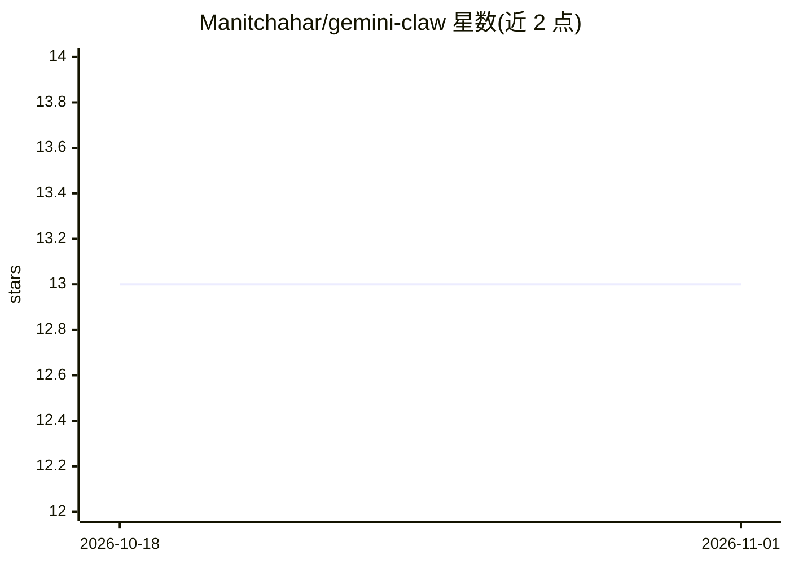

# Manitchahar/gemini-claw

⭐ 13 · TypeScript · MIT · 推送 2026-06-11 · [GitHub](https://github.com/Manitchahar/gemini-claw) · 个人维护

**把 Telegram 变成 Gemini CLI 私有操作界面的个人 AI 代理**

面向个人用户的 Node.js/TypeScript 应用：将 Telegram bot 接入官方 gemini CLI，仅允许白名单用户在私聊中使用。核心机制包括基于会话 ID 的会话延续、stream-JSON 输出解析、/task 后台并发 worker（可配额排队与取消隔离会话）、终端操作员实时日志、技能/扩展/MCP 管理。Gemini 集成隔离在可替换的 GeminiClient 适配器后。限制：强制 --yolo 模式且无法关闭，不支持图片/语音等多模态输入，需在可信机器使用。

## 筛选速览

| 维度 | 判定 | 备注 |
|---|---|---|
| AI 角色 | `ai-ecosystem` | LLM/agent 周边工具 |
| 许可风险 | `permissive` | MIT |
| 部署形态 | `library` | 以包/库形式分发 |
| 模型依赖 | — | README 未给出锁定关系 |
| 硬件要求 | — | 无带数字的原话,不猜 |
| 安装摩擦 | `low` | 无编译、无系统依赖或容器化 |
| 成熟度 | — | 结构信号不足 |

## 能力要点

- Telegram 白名单私聊接入 Gemini CLI，非白名单用户在调用前被拒绝
- /task 启动隔离会话的后台并发 worker，支持排队、取消与任务持久化
- stream-JSON 解析实现运行中工具/内容事件与子代理观测
- 技能安装/启停与 Gemini CLI 扩展、MCP 服务器配置管理

## 适用场景

- 通过 Telegram 私聊远程驱动本机 Gemini CLI 做自动化任务
- 让多个 Gemini 后台任务并发运行并随时查看/取消状态
- 把 Telegram 作为个人 AI 操作员界面而无需公开 Web UI

## 场景标签

`AI 助手` `编码 Agent` · 领域:编码与开发

## 证据(README 行号)

> L3: Telegram-native Gemini CLI personal AI operator with private allowlisted chats.
> L5: Gemini Claw turns a Telegram bot into a private operator interface for the official `gemini` CLI. It keeps the trans
> L133: gemini --prompt "<assistant prompt>" --output-format stream-json --yolo

## 星数曲线

2026-10-18 13 → 2026-11-01 13（+0）

---
*卡片 v1 · prompt 1.4 · 生成 2026-10-31 · 置信度 high · 依据 README sha `576fdc625c86` · [字段定义](../../DATASET.md)*
