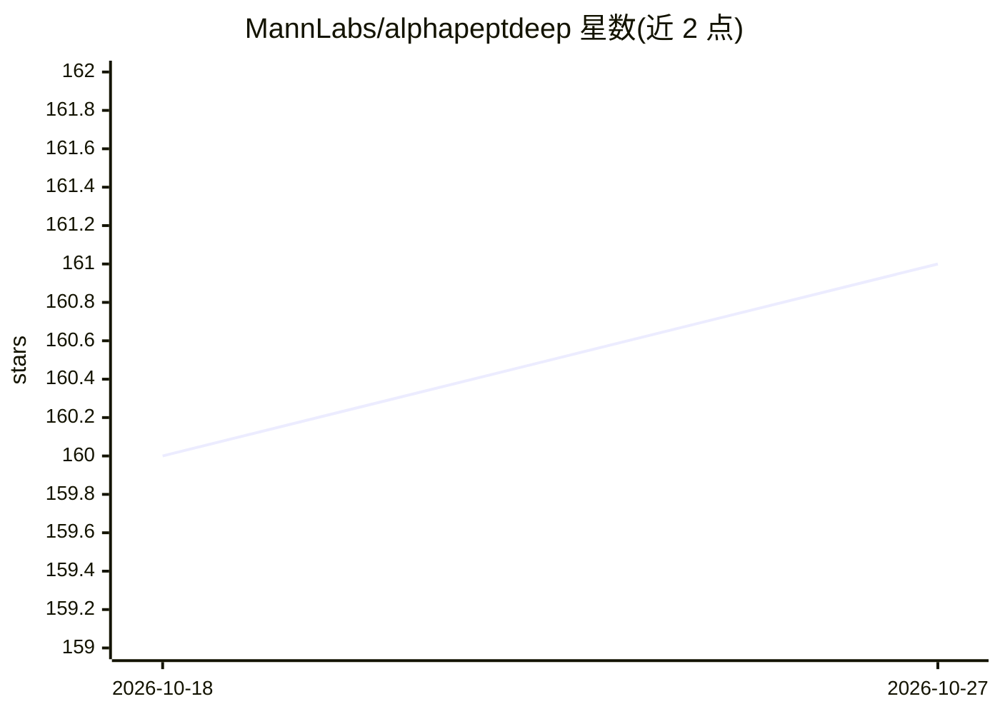

# MannLabs/alphapeptdeep

⭐ 161 · Jupyter Notebook · Apache-2.0 · 推送 2026-08-31 · [GitHub](https://github.com/MannLabs/alphapeptdeep) · 组织维护

**蛋白质组学深度学习框架：预测肽段 RT/CCS/MS2 并生成谱库**

面向 shotgun 蛋白质组学研究的深度学习框架（PyPI 包名 peptdeep），支持构建新模型与迁移学习。内置保留时间（RT）、碰撞截面（CCS）、二级质谱（MS2）三类预测模型，可从 fasta 文件生成预测谱库，另含 Percolator 重打分特征提取。提供 GUI、CLI、Python 三种使用方式；安装覆盖一键 GUI 安装包、pip、conda 开发者模式与 Docker。GPU 需另行安装 PyTorch CUDA 版本；一键安装包不含 GPU 支持。

## 筛选速览

| 维度 | 判定 | 备注 |
|---|---|---|
| AI 角色 | `ai-native` | 本体是模型或模型工具 |
| 许可风险 | `permissive` | Apache-2.0 |
| 部署形态 | `desktop` | 安装包/桌面程序 |
| 模型依赖 | — | README 未给出锁定关系 |
| 硬件要求 | — | 无带数字的原话,不猜 |
| 安装摩擦 | `low` | 无编译、无系统依赖或容器化 |
| 成熟度 | — | 结构信号不足 |

## 能力要点

- 内置 RT/CCS/MS2 预测模型，从 fasta 生成预测谱库
- 支持迁移学习与自定义深度学习模型构建
- GUI/CLI/Python 三种使用方式，跨 Windows/macOS/Linux
- 提供一键 GUI 安装包与 Docker 镜像

## 适用场景

- 从蛋白质序列文件预测生成 LC-MS/MS 分析用谱库
- 用自有数据对 RT/CCS/MS2 模型做迁移学习精调
- 在 Jupyter/CLI 流程中集成肽段性质预测

## 场景标签

 · 领域:生物信息学/蛋白质组学

## 证据(README 行号)

> L33: AlphaPeptDeep (`peptdeep` for short) aims to easily build new deep
> L37: It contains some built-in models such as retention time (RT), collision

## 星数曲线

2026-10-18 160 → 2026-10-27 161（+1）

---
*卡片 v1 · prompt 1.4 · 生成 2026-10-22 · 置信度 high · 依据 README sha `2004943eba8b` · [字段定义](../../DATASET.md)*
