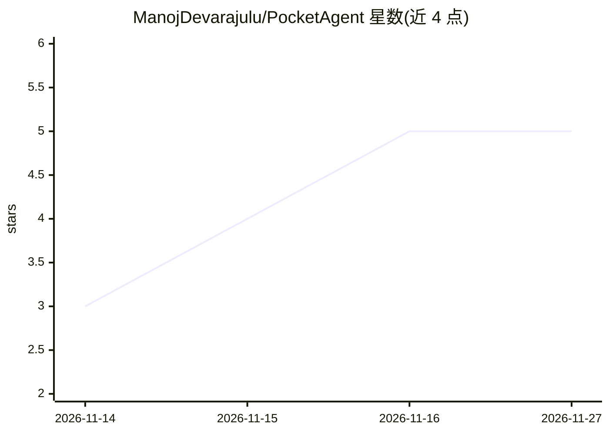

# ManojDevarajulu/PocketAgent

⭐ 5 · Kotlin · AGPL-3.0 · 推送 2026-11-15 · [GitHub](https://github.com/ManojDevarajulu/PocketAgent) · 个人维护

**Android 端侧自主 AI 代理：免 PC/ADB/后端操作手机应用**

一个独立运行在 Android 手机上的开源应用，通过悬浮气泡接收语音或文字指令，读取当前屏幕、规划动作并经 AccessibilityService 原生执行手势，完成应用内导航与任务。采用 BYOK 模式，直接调用用户自选的模型服务商端点，无 PC、无 ADB、无需 root、无云后端。内置 Kotlin 确定性安全门：屏蔽银行/支付类敏感应用，不可逆操作需确认，API 密钥用 Android Keystore AES-256-GCM 加密。支持 Computer Link（MCP）、语音循环、操作录制生成 playbook 等。安装需 Android 11+，源码构建需 Java 17+/Android SDK。

## 筛选速览

| 维度 | 判定 | 备注 |
|---|---|---|
| AI 角色 | `ai-native` | 本体是模型或模型工具 |
| 许可风险 | `viral` | AGPL-3.0 |
| 部署形态 | `desktop` | 安装包/桌面程序 |
| 模型依赖 | local-ok | 支持本地模型 |
| 硬件要求 | — | 无带数字的原话,不猜 |
| 安装摩擦 | `medium` | 含编译或系统依赖之一 |
| 成熟度 | — | 结构信号不足 |

## 能力要点

- 悬浮气泡触发 + AccessibilityService 原生手势执行，零 PC/零 ADB/零后端
- BYOK 直连 8 类服务商端点，含本地 Ollama 与任意 OpenAI 兼容自托管端点
- Kotlin 确定性安全门：敏感应用屏蔽、不可逆操作确认、提示注入防护、Keystore 密钥加密
- 截图网格标注模式支持无障碍树读不出的游戏与自绘应用

## 适用场景

- 在手机上用自然语言让 AI 代为操作应用完成任务
- 通过本地 Ollama 在局域网内运行不外发的手机代理
- 用语音完成免手动操作并逐项确认执行
- 录制常用操作生成 playbook 供复用与分享

## 场景标签

`GUI 自动化` · 领域:效率与自动化

## 证据(README 行号)

> L5: **An on-device AI agent for Android that operates apps and your phone autonomously.**
> L33: **Pocket Agent lives directly on your phone.** It is a standalone, open-source Android app that operates your phone
> L35: You bring your own API key (Anthropic, OpenRouter, OpenAI, Gemini, DeepSeek, Groq, or a local Ollama server) and se

## 星数曲线

2026-11-14 3 → 2026-11-27 5（+2）

---
*卡片 v1 · prompt 1.4 · 生成 2026-11-21 · 置信度 high · 依据 README sha `f0824589054b` · [字段定义](../../DATASET.md)*
