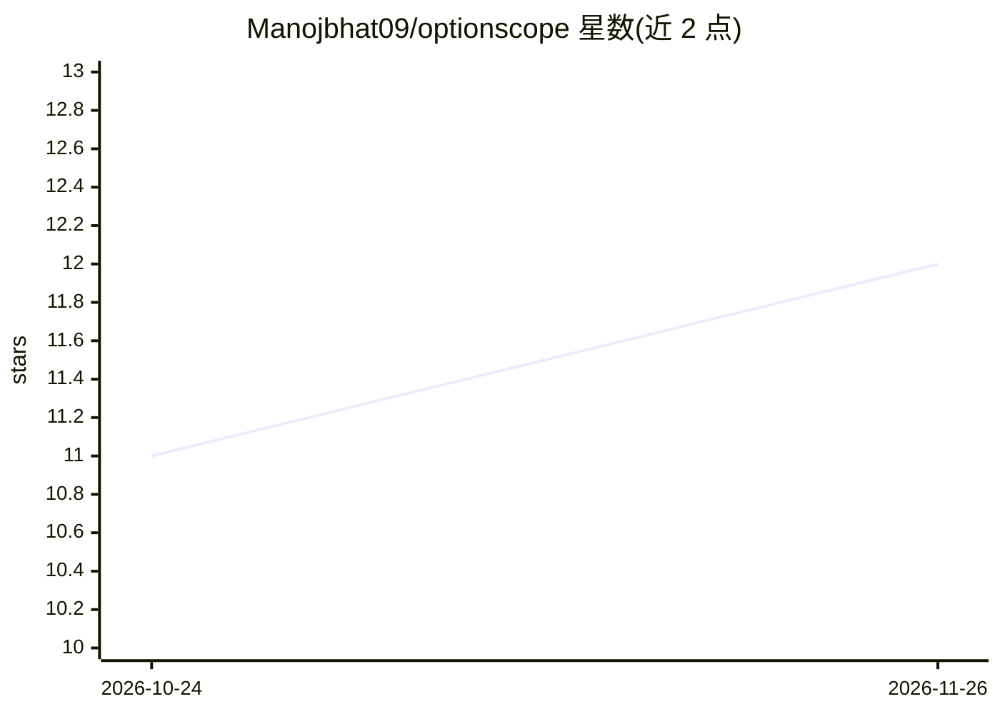

# Manojbhat09/optionscope

⭐ 12 · JavaScript · 推送 2026-08-25 · [GitHub](https://github.com/Manojbhat09/optionscope) · [官网](https://optionscope-ryto.onrender.com) · 个人维护

**给期权交易者的本地交易分析与 AI 辅助复盘仪表盘**

基于 React + Flask 的本地运行 Web 应用，从 Robinhood 拉取期权交易历史或经 CSV 导入，提供 P/L 统计、累计收益曲线、胜率与盈亏日历等分析。Trade Replay 将任意已平仓头寸回放到股票图表（买卖标记、VIX 叠加、RSI、新闻上下文）；Spot Replay 通过 agent 管线做 Monte-Carlo 模拟、Gradient Boosting/ARIMA 预测并给出持有/卖出期望值。内置可看页面上下文的 AI 助手，并提供 MCP server 让外部 agent 操控应用。数据与凭据均留在本地。

## 筛选速览

| 维度 | 判定 | 备注 |
|---|---|---|
| AI 角色 | `ai-enhanced` | 去掉 AI 部分产品仍成立 |
| 许可风险 | `permissive` | — |
| 部署形态 | `desktop` | 安装包/桌面程序 |
| 模型依赖 | local-ok | 支持本地模型 |
| 硬件要求 | — | 无带数字的原话,不猜 |
| 安装摩擦 | `low` | 无编译、无系统依赖或容器化 |
| 成熟度 | — | 结构信号不足 |

## 能力要点

- 从 Robinhood 安全拉取或 CSV 导入期权交易数据，100% 本地运行
- Trade Replay 将持仓回放到股票图表（买卖标记、VIX、RSI）
- Spot Replay agent 管线输出 Monte-Carlo 模拟与 ML 预测的期望值报告
- 内置 AI 助手与 MCP server，支持 Claude Desktop 等外部客户端驱动应用

## 适用场景

- 复盘历史期权交易，找出盈亏模式与最佳/最差入场形态
- 对当前持有的期权仓位做持有 vs 卖出的期望值分析
- 在本地环境用对话式 AI 助手查询自己的交易数据

## 场景标签

`金融量化` · 领域:学习与行业

## 证据(README 行号)

> L26: Supercharge your Robinhood options trading strategy with data-driven insights! Optionscope is a powerful web applic
> L42: …all wrapped by a **persistent AI assistant** that can see every page, and an **MCP server** that lets external AI 
> L93: 2. Hit **Run Analysis** — an agent pipeline fetches market data, runs web research (DuckDuckGo), Monte-Carlo simula

## 星数曲线

2026-10-24 11 → 2026-11-26 12（+1）

---
*卡片 v1 · prompt 1.4 · 生成 2026-11-19 · 置信度 high · 依据 README sha `09149b5003e1` · [字段定义](../../DATASET.md)*
