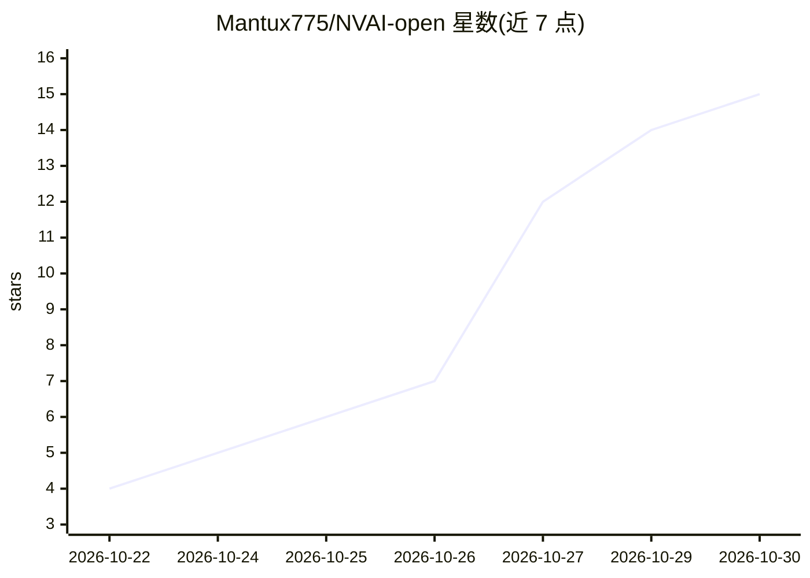

# Mantux775/NVAI-open

⭐ 15 · Swift · NOASSERTION · 推送 2026-10-29 · [GitHub](https://github.com/Mantux775/NVAI-open) · [官网](https://github.com/Mantux775/NVAI-open/releases) · 个人维护

**本地图像/视频/音乐/3D 生成桌面应用，免云免订阅**

面向创作者与游戏开发者的本地多模态生成应用：在自有显卡上运行图像模型（FLUX 3、Qwen-Image-2512、Krea 2、MOSS-Image）、LTX-2.5 视频（含语音音效，最长 20 秒 1080p）、器乐、图生 3D（TRELLIS.2/TripoSG）与老照片修复。内含多轨视频剪辑 Studio，支持 LoRA、提示词扩写、无内置审查（无过滤模型一键可用）。支持 NVIDIA/AMD/Apple Silicon，通过 MCP 供 Claude Code 调用，提供 Windows/macOS 安装包。作者个人维护，仅在自有硬件（RTX 5060 Ti、Mac mini M1）上测试。

## 筛选速览

| 维度 | 判定 | 备注 |
|---|---|---|
| AI 角色 | `ai-native` | 本体是模型或模型工具 |
| 许可风险 | `none` | NOASSERTION |
| 部署形态 | `desktop` | 安装包/桌面程序 |
| 模型依赖 | locked-api |  |
| 硬件要求 | `gpu-8g` | |
| 安装摩擦 | `low` | 无编译、无系统依赖或容器化 |
| 成熟度 | — | 结构信号不足 |

## 能力要点

- LTX-2.5 单次生成带语音与音效的视频（最长 20 秒 1080p）
- 图像到带纹理 3D 模型（GLB，TRELLIS.2/TripoSG）
- 含多轨剪辑的 Studio，导出 YouTube 1080p/4K、ProRes 4444
- MCP server 供 Claude Code 生成资产
- 无内置审查，uncensored 模型一键可用

## 适用场景

- 在自己的电脑上生成图像、视频、音乐与 3D 模型，不依赖云服务
- 从一张人像照片生成带语音的视频
- 把生成结果在 Studio 中剪辑成完整视频并导出
- 让 Claude Code 在编码时通过 MCP 生成项目所需资产

## 场景标签

`图像生成` `视频生成` `语音合成` · 领域:内容生成

## 证据(README 行号)

> L3: Images, videos with sound, music and 3D models, made on your own computer. Free, private, no account, no subscriptio
> L40: - **Images:** FLUX 3, Qwen-Image-2512, Krea 2, MOSS-Image and many more. Edit with reference images, fill in or ext
> L41: - **Video with sound:** LTX-2.5 makes the picture and the sound in one pass, speech included, up to 20 s and 1080p.

## 星数曲线

2026-10-22 4 → 2026-10-30 15（+11）

---
*卡片 v1 · prompt 1.4 · 生成 2026-10-30 · 置信度 high · 依据 README sha `f295165cc05d` · [字段定义](../../DATASET.md)*
