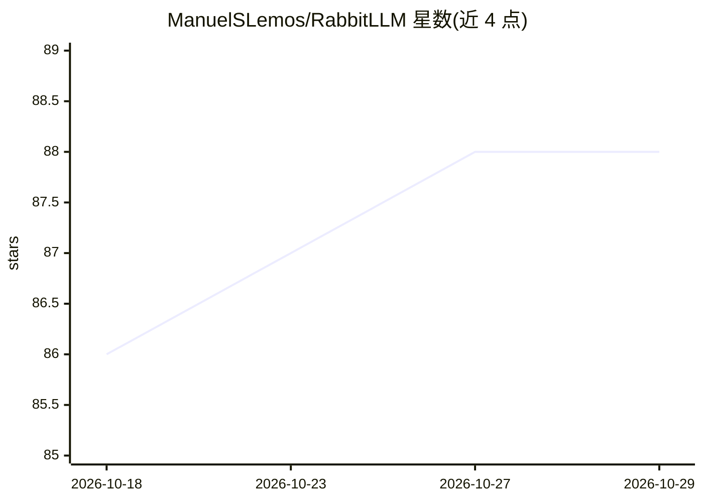

# ManuelSLemos/RabbitLLM

⭐ 88 · Python · Apache-2.0 · 推送 2026-02-28 · [GitHub](https://github.com/ManuelSLemos/RabbitLLM) · 个人维护

**AirLLM 分支：4GB 显存逐层流式推理 70B+ 大模型**

AirLLM 的 fork，以 Python 库（pip 安装）形式提供：将 HuggingFace checkpoint 切分为逐层 safetensors，单层加载至 GPU 前向后释放，配合后台预取，使 70B+ 模型可在 4GB VRAM 消费级 GPU 上推理，无需量化/蒸馏/剪枝。可选 4bit/8bit 块压缩（bitsandbytes）、GPU Direct Storage（kvikio）、KV cache 落盘支持 50k+ 长上下文。目前仅 Qwen2/Qwen3 架构经测试可用，Llama/Mistral 等存在但未兼容；不支持 Apple Silicon，需 CUDA GPU（或 x86/ARM Linux CPU 回退）。提供 Dockerfile 与基准脚本。

## 筛选速览

| 维度 | 判定 | 备注 |
|---|---|---|
| AI 角色 | `ai-ecosystem` | LLM/agent 周边工具 |
| 许可风险 | `permissive` | Apache-2.0 |
| 部署形态 | `self-host` | docker 或自建部署 |
| 模型依赖 | — | README 未给出锁定关系 |
| 硬件要求 | `gpu-8g` | |
| 安装摩擦 | `low` | 无编译、无系统依赖或容器化 |
| 成熟度 | — | 结构信号不足 |

## 能力要点

- 逐层流式加载使 70B+ 模型在 4GB VRAM 上运行
- 可选 4bit/8bit 块压缩（NF4 约 28% 体积）
- GPU Direct Storage 与 KV cache 落盘（50k+ token 上下文）
- AutoModel 自动识别 HuggingFace 模型架构

## 适用场景

- 在低显存消费级 GPU 上运行 Qwen2.5-72B 等大模型
- 长上下文推理时将 KV cache 卸载到 SSD
- 对比 CPU/CUDA、不同注意力实现的推理吞吐

## 场景标签

`推理引擎` · 领域:训练与推理

## 证据(README 行号)

> L13: RabbitLLM is a **fork of AirLLM**. It enables inference on large language models (70B+ parameters) on consumer GPUs
> L25: 1. **Splits** the HuggingFace checkpoint into per-layer safetensors files (once, on first use).
> L26: 2. **Streams** each layer individually: load to GPU → forward pass → free GPU memory.

## 星数曲线

2026-10-18 86 → 2026-10-29 88（+2）

---
*卡片 v1 · prompt 1.4 · 生成 2026-10-23 · 置信度 high · 依据 README sha `caed8bd54397` · [字段定义](../../DATASET.md)*
