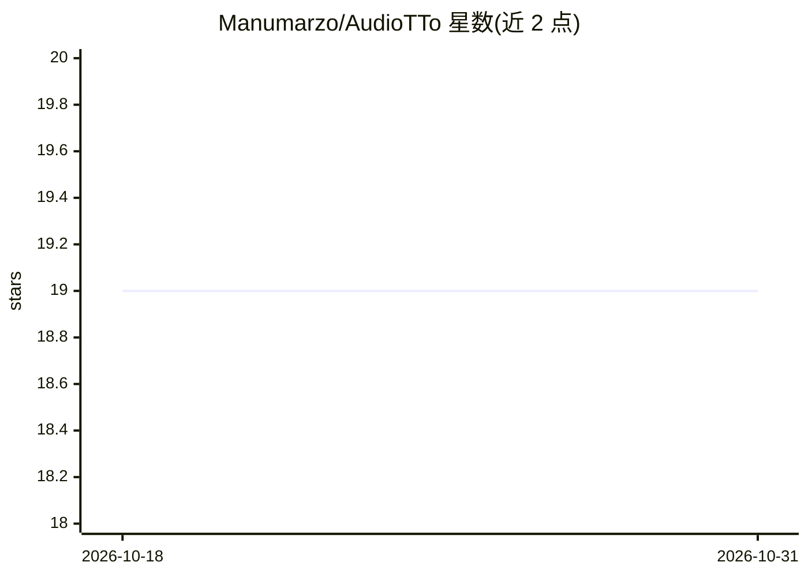

# Manumarzo/AudioTTo

⭐ 19 · Python · MIT · 推送 2026-05-25 · [GitHub](https://github.com/Manumarzo/AudioTTo) · 个人维护

**将录音与 PDF 幻灯片转成结构化 LaTeX 学习笔记的工具**

面向学生与记录者的 Python 桌面应用：读取讲座、会议等音频，用 Faster-Whisper 在本地分块并行转录；可选拖入 PDF 幻灯片，提取其中图片；再调用 Google Gemini API 把转录文本综合为结构化 LaTeX 笔记，并在本地编译为 PDF。提供 Web GUI（拖放操作）与 CLI 两种使用方式，Windows/macOS/Linux 提供独立可执行文件，也可从源码运行。运行需要 LaTeX 发行版、FFmpeg/FFprobe（源码方式）与 Gemini API Key；转录在本地完成，摘要依赖云端 Gemini。

## 筛选速览

| 维度 | 判定 | 备注 |
|---|---|---|
| AI 角色 | `ai-native` | 本体是模型或模型工具 |
| 许可风险 | `permissive` | MIT |
| 部署形态 | `desktop` | 安装包/桌面程序 |
| 模型依赖 | — | README 未给出锁定关系 |
| 硬件要求 | — | 无带数字的原话,不猜 |
| 安装摩擦 | `medium` | 含编译或系统依赖之一 |
| 成熟度 | — | 结构信号不足 |

## 能力要点

- Faster-Whisper 本地转录，音频自动分块并行处理
- Gemini API 将转录与幻灯片图片综合为 LaTeX 笔记并编译 PDF
- Web GUI 拖放操作与 CLI 两种使用方式
- Windows/macOS/Linux 提供独立可执行文件

## 适用场景

- 把课程讲座录音整理成可排版的 LaTeX 学习笔记
- 结合 PDF 幻灯片生成含插图的结构化笔记
- 无界面环境批量转录音频

## 场景标签

`语音识别` `AI 写作` · 领域:内容生成

## 证据(README 行号)

> L18: **AudioTTo** is a powerful Python application designed to streamline the process of creating study notes. It takes 
> L22: - 🎙️ **Local Transcription**: Uses `Faster-Whisper` for fast, accurate, and private audio transcription.
> L24: - 🧠 **AI-Powered Notes**: Leverages **Google Gemini AI** to synthesize transcripts into structured LaTeX notes.

## 星数曲线

2026-10-18 19 → 2026-10-31 19（+0）

---
*卡片 v1 · prompt 1.4 · 生成 2026-10-29 · 置信度 mid · 依据 README sha `2eb9371f292e` · [字段定义](../../DATASET.md)*
