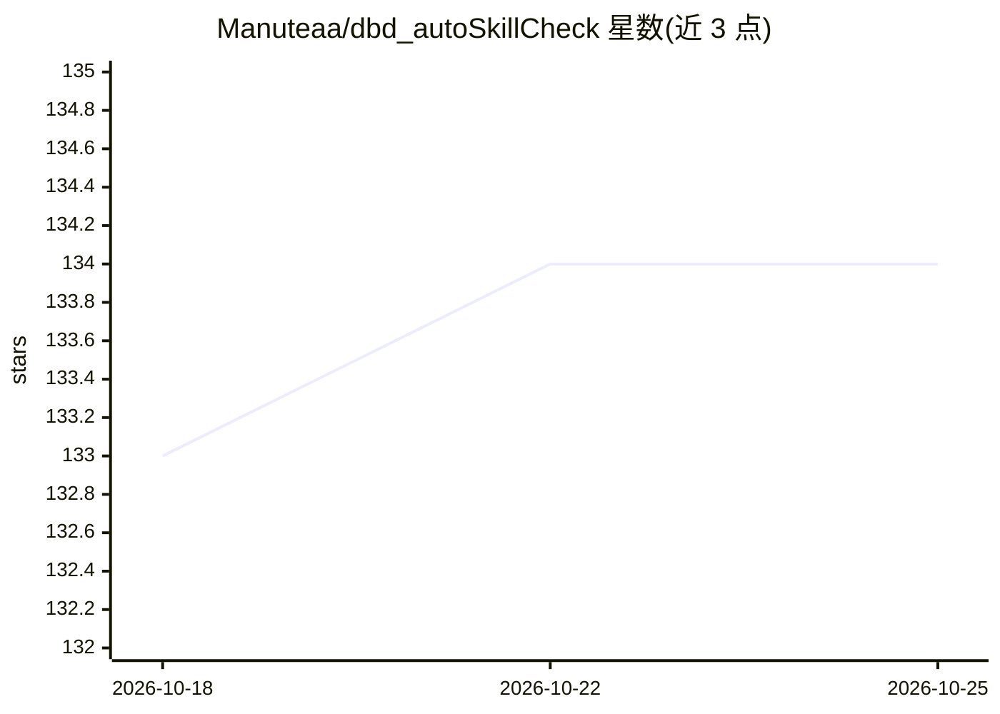

# Manuteaa/dbd_autoSkillCheck

⭐ 134 · Python · GPL-3.0 · 推送 2026-08-21 · [GitHub](https://github.com/Manuteaa/dbd_autoSkillCheck) · 个人维护

**AI 检测并自动命中黎明杀机完美技能校验的桌面应用**

面向 Dead by Daylight 玩家的 AI 桌面应用：本地运行（无需联网）监控屏幕 224x224 区域，检测到完美技能校验时自动按空格键。模型基于 ShuffleNet V2 X0.5（改最后一层为 10 分类），训练使用 focal loss 与 L1 正则，推理部署于 ONNX Runtime（CPU 单线程 180 帧/秒、准确率 98.67%）。开源版提供功能受限的轻量模型，完整版需经 Discord 加入。README 明示使用可能违反游戏规则或触发反作弊。

## 筛选速览

| 维度 | 判定 | 备注 |
|---|---|---|
| AI 角色 | `ai-native` | 本体是模型或模型工具 |
| 许可风险 | `viral` | GPL-3.0 |
| 部署形态 | `desktop` | 安装包/桌面程序 |
| 模型依赖 | — | README 未给出锁定关系 |
| 硬件要求 | — | 无带数字的原话,不猜 |
| 安装摩擦 | `low` | 无编译、无系统依赖或容器化 |
| 成熟度 | — | 结构信号不足 |

## 能力要点

- 监控 224x224 屏幕区域并自动按空格命中完美校验
- ShuffleNet V2 X0.5 + ONNX Runtime 实时推理（CPU 180 帧/秒）
- focal loss + L1 正则训练，按各类别平均 F1 选模型
- 提供嵌入式 Python 发行包与源码构建两种安装方式

## 适用场景

- 私局、视频录制或技能校验模拟器中测试 AI 实时检测
- 研究计算机视觉模型在多人游戏延迟约束下的运行

## 场景标签

`目标检测` `GUI 自动化` · 领域:效率与自动化

## 证据(README 行号)

> L3: _DBD Auto Skill Check_ is an AI research project that detects and automatically hits great skill checks in Dead by D
> L5: Our application provides a desktop interface for configuring and running our AI model **on your computer** (no inter
> L7: The project uses PyTorch for training and ONNX Runtime for real-time inference, with optional GPU support. It demons

## 星数曲线

2026-10-18 133 → 2026-10-25 134（+1）

---
*卡片 v1 · prompt 1.4 · 生成 2026-10-22 · 置信度 high · 依据 README sha `abfe11e5923c` · [字段定义](../../DATASET.md)*
