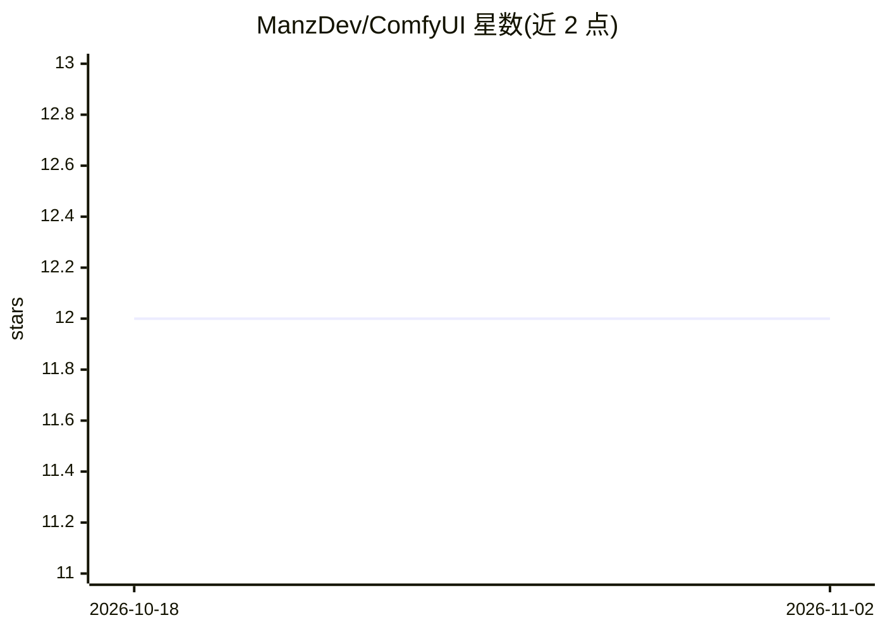

# ManzDev/ComfyUI

⭐ 12 · Dockerfile · 推送 2025-12-28 · [GitHub](https://github.com/ManzDev/ComfyUI) · 个人维护

**在 Windows/WSL2 上以 Docker 运行 ComfyUI 的镜像封装**

提供 ComfyUI 的 Docker 化封装，用于在 Windows/WSL2 环境中隔离并简化安装。要求 Docker、WSL2、NVIDIA 驱动、CUDA Toolkit 13.1 与 NVIDIA Container Toolkit；通过 start 脚本构建镜像并启动容器（建议 WSL2 至少预留 15GB），生成的图像输出保存在 output/ 目录。预装 ComfyUI Manager、Custom Scripts、Ollama 插件、GGUF 支持等 7 个插件，支持图像与视频（WAN2.2）生成工作流。

## 筛选速览

| 维度 | 判定 | 备注 |
|---|---|---|
| AI 角色 | `ai-ecosystem` | LLM/agent 周边工具 |
| 许可风险 | `none` | — |
| 部署形态 | `self-host` | docker 或自建部署 |
| 模型依赖 | local-ok | 支持本地模型 |
| 硬件要求 | — | 无带数字的原话,不猜 |
| 安装摩擦 | `low` | 无编译、无系统依赖或容器化 |
| 成熟度 | — | 结构信号不足 |

## 能力要点

- start 脚本自动构建镜像、创建容器并以低内存模式启动 ComfyUI
- 预装 7 个插件：Manager、Custom Scripts、Ollama、Rembg、GGUF 等
- 支持图像（checkpoint 如 Juggernaut XL）与视频（WAN2.2 + LoRA）生成工作流

## 适用场景

- 在 Windows/WSL2 上隔离安装运行 ComfyUI，避免环境配置
- 让容器使用本地 NVIDIA GPU 生成图像或视频
- 通过 models/ 目录共享模型与 LoRA，output/ 保存生成结果

## 场景标签

`图像生成` `视频生成` · 领域:内容生成

## 证据(README 行号)

> L1: # ComfyUI (Docker)
> L3: Versión dockerizada de ComfyUI para aislar y simplificar toda la instalación.
> L46: El script `start` genera la imagen de docker (recomendado tener al menos unos 15GB libres en WSL2), crea un contene

## 星数曲线

2026-10-18 12 → 2026-11-02 12（+0）

---
*卡片 v1 · prompt 1.4 · 生成 2026-11-01 · 置信度 high · 依据 README sha `7e3c28f2bfa2` · [字段定义](../../DATASET.md)*
