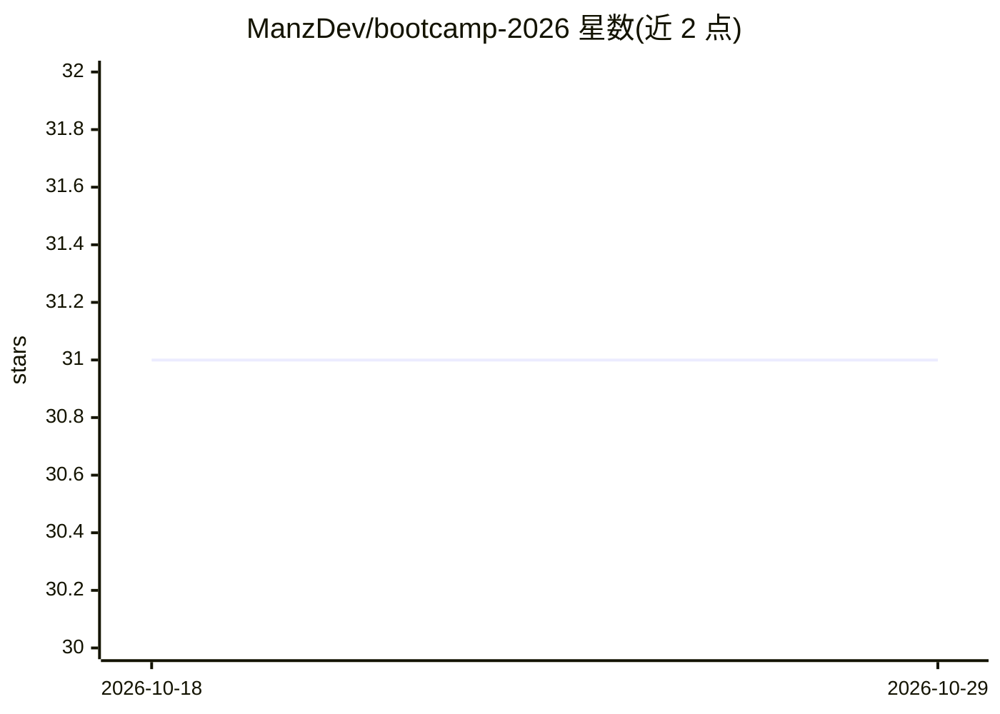

# ManzDev/bootcamp-2026

⭐ 31 · 推送 2026-02-25 · [GitHub](https://github.com/ManzDev/bootcamp-2026) · [官网](https://bootcamp.manz.dev/) · 个人维护

**面向初学者的免费 Web 开发训练营课程仓库（含视频）**

由 ManzDev 在 Twitch/YouTube 授课的免费 Web 开发训练营配套仓库：以 vanilla 技术讲解从零基础到进阶的内容，强调理解概念。README 列出课程视频链接，主题覆盖 WSL 与终端、JavaScript 编程基础、Git/GitHub 项目管理，以及一节涉及 OpenCode、Ollama 与 ComfyUI 的人工智能课。课程大纲、幻灯片与常见问题在 bootcamp.manz.dev 网站上，仓库本身不含代码安装流程。

## 筛选速览

| 维度 | 判定 | 备注 |
|---|---|---|
| AI 角色 | `ai-knowledge` | 知识聚合/清单类 |
| 许可风险 | `none` | — |
| 部署形态 | `None` |  |
| 模型依赖 | — | README 未给出锁定关系 |
| 硬件要求 | — | 无带数字的原话,不猜 |
| 安装摩擦 | `low` | 无编译、无系统依赖或容器化 |
| 成熟度 | — | 结构信号不足 |

## 能力要点

- 从零基础到进阶的 Web 开发课程结构（vanilla 技术路线）
- 每节课附完整视频（YouTube）与播放列表
- 涉及 Git/GitHub 及 AI 工具（OpenCode + Ollama + ComfyUI）一课

## 适用场景

- 跟随视频从零系统学习 Web 开发
- 了解课程大纲与讲师的其他学习资源站点

## 场景标签

`教程课程` · 领域:学习与行业

## 证据(README 行号)

> L1: Bootcamp de Desarrollo web gratuito
> L43: ### Clase 4: Inteligencia Artificial (OpenCode + Ollama + ComfyUI)

## 星数曲线

2026-10-18 31 → 2026-10-29 31（+0）

---
*卡片 v1 · prompt 1.4 · 生成 2026-10-26 · 置信度 high · 依据 README sha `157af8b5c71e` · [字段定义](../../DATASET.md)*
