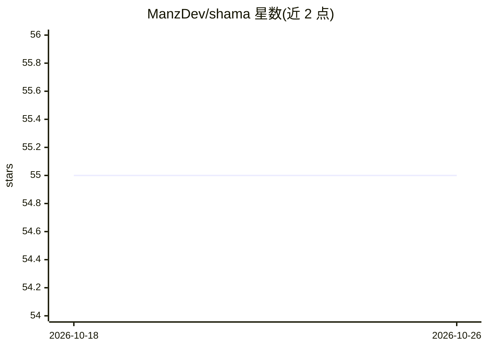

# ManzDev/shama

⭐ 55 · JavaScript · 推送 2026-05-05 · [GitHub](https://github.com/ManzDev/shama) · [官网](https://youtu.be/Vvb_KYCTD2w) · 个人维护

**让 llama.cpp 在终端更易用并接入 opencode 的本地 AI 开发脚本**

Shama 是一个 Node 脚本形式的 wrapper，用于简化从终端使用 llama.cpp：搜索本地 ~/.models/gguf 文件夹中的 GGUF 模型，高亮关键信息，并更新 opencode（或其他 agent）的配置文件以接入本地模型。面向拥有 NVIDIA 显卡的开发者，前提是先在 WSL2 或 Docker 中自行编译安装 llama.cpp（CUDA 支持），并安装 Node、Docker、NVIDIA 驱动与 Container Toolkit。README 为西班牙语。

## 筛选速览

| 维度 | 判定 | 备注 |
|---|---|---|
| AI 角色 | `ai-ecosystem` | LLM/agent 周边工具 |
| 许可风险 | `none` | — |
| 部署形态 | `None` |  |
| 模型依赖 | local-ok | 支持本地模型 |
| 硬件要求 | — | 无带数字的原话,不猜 |
| 安装摩擦 | `high` | 编译与系统依赖俱全 |
| 成熟度 | — | 结构信号不足 |

## 能力要点

- 从本地文件夹自动查找 GGUF 模型
- 更新 opencode 配置以接入本地 llama.cpp 服务
- 针对 llama.cpp + CUDA + WSL2/Docker 的安装指引

## 适用场景

- 在本地用带 NVIDIA 显卡的机器跑模型供 opencode 开发使用
- 简化 llama.cpp 在终端的日常调用与模型切换

## 场景标签

`推理引擎` · 领域:训练与推理

## 证据(README 行号)

> L3: Shama es un simple wrapper que hace más legible y sencillo el uso de llama.cpp desde una terminal. Simplemente desta
> L5: El objetivo de este script es montar un sistema de Inteligencia Artificial de modo que puedas utilizarlo en local pa
> L62: El fichero `shama` de este repo es un wrapper/script para que sea más sencillo trabajar con `llama`. Simplemente no

## 星数曲线

2026-10-18 55 → 2026-10-26 55（+0）

---
*卡片 v1 · prompt 1.4 · 生成 2026-10-24 · 置信度 high · 依据 README sha `d4b826eef37f` · [字段定义](../../DATASET.md)*
