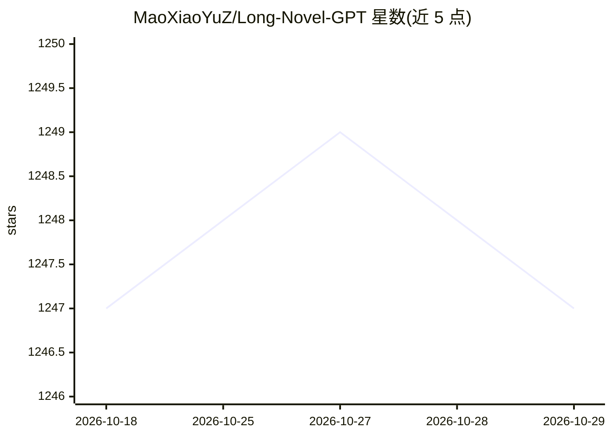

# MaoXiaoYuZ/Long-Novel-GPT

⭐ 1,247 · Python · 推送 2025-11-05 · [GitHub](https://github.com/MaoXiaoYuZ/Long-Novel-GPT) · 个人维护 · 中文 README

**基于 LLM+RAG 的长篇小说生成器，供网文创作者使用**

面向小说创作者的长篇小说生成应用：核心是基于 LLM 和 RAG 的 Long Novel Agent，采用大纲-章节-正文自上而下扩写流程，生成过程中检索相关正文片段与剧情纲要并同步修改更新。支持导入现有小说进行拆书（提取剧情人物关系、生成剧情纲要）后改写，自动管理上下文与多线程并行生成，可生成百万字级小说。提供 Docker 一键部署，通过 .env 配置 API；兼容 OpenAI 格式接口的本地大模型服务，另附 Gradio 在线 Demo 与多种写作风格 Prompt 及教程。

## 筛选速览

| 维度 | 判定 | 备注 |
|---|---|---|
| AI 角色 | `ai-native` | 本体是模型或模型工具 |
| 许可风险 | `none` | — |
| 部署形态 | `self-host` | docker 或自建部署 |
| 模型依赖 | — | README 未给出锁定关系 |
| 硬件要求 | — | 无带数字的原话,不猜 |
| 安装摩擦 | `low` | 无编译、无系统依赖或容器化 |
| 成熟度 | — | 结构信号不足 |

## 能力要点

- 大纲-章节-正文自上而下扩写的长篇小说 Agent
- 支持导入现有小说拆书后在其基础上改写
- 自动管理上下文，多线程并行生成，支持百万字级小说
- Docker 一键部署，支持 OpenAI 格式接口的本地模型服务

## 适用场景

- 输入创意和意见，让 AI 逐步扩写成长篇小说
- 导入已有小说，提取剧情纲要后按意见改写
- 选择特定写作风格 Prompt 创作或润色网文

## 场景标签

`AI 写作` · 领域:内容生成

## 证据(README 行号)

> L15: Long-Novel-GPT的核心是一个基于LLM和RAG的长篇小说Agent，根据用户的提问（要写什么小说，要对什么情节做出什么改动），LNGPT会采用大纲-章节-正文的自上而下扩写来一步步生成最终长篇小说，在生成过程中调用工具
> L3:  AI一键生成长篇小说

## 星数曲线

2026-10-18 1,247 → 2026-10-29 1,247（+0）

---
*卡片 v1 · prompt 1.4 · 生成 2026-10-21 · 置信度 high · 依据 README sha `ed4af78ea12b` · [字段定义](../../DATASET.md)*
