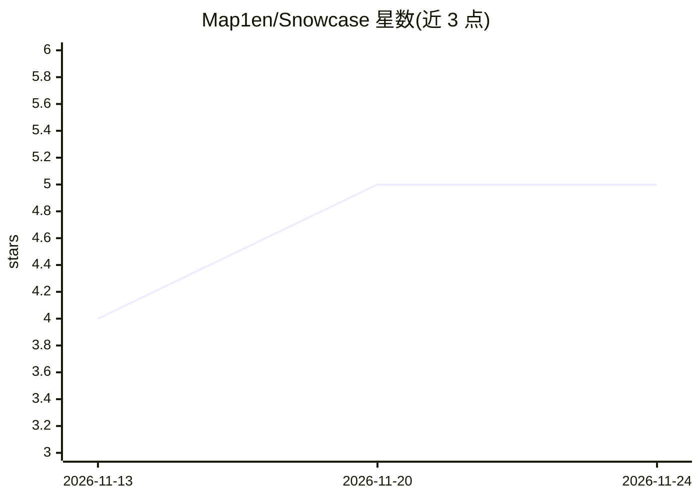

# Map1en/Snowcase

⭐ 5 · Rust · GPL-3.0 · 推送 2026-11-23 · [GitHub](https://github.com/Map1en/Snowcase) · 个人维护 · 中文 README

**面向 BOOTH 生态的本地素材管理器，覆盖 VRChat 头像资产流程**

为 BOOTH 生态构建的本地素材管理器，同时管理磁盘上已有的包与其他网站购买的商品：预览 .unitypackage 内容（含图片与 3D 模型）、记录资产来源与用途、读取 VN3 许可条款并提示限制、统计资产在 Unity 项目与已上传头像中的使用情况、按版本清理存储空间、同步 BOOTH 购买记录，并集成 VRCX-0。数据全部保留在本机。当前处于早期开发阶段，尚无可使用功能。Windows 优先，macOS/Linux 计划中。

## 筛选速览

| 维度 | 判定 | 备注 |
|---|---|---|
| AI 角色 | `ai-enhanced` | 去掉 AI 部分产品仍成立 |
| 许可风险 | `viral` | GPL-3.0 |
| 部署形态 | `None` |  |
| 模型依赖 | — | README 未给出锁定关系 |
| 硬件要求 | — | 无带数字的原话,不猜 |
| 安装摩擦 | `low` | 无编译、无系统依赖或容器化 |
| 成熟度 | `idea` | |

## 能力要点

- 无需打开 Unity 即可预览 .unitypackage 内容
- 读取 VN3 许可条款并提示公开上传/再分发等限制
- 统计资产在 Unity 项目与头像中的使用与版本
- 数据全部保留本机，不上传或共享资产文件

## 适用场景

- 统一管理来自 BOOTH 与其他渠道的 VRChat 素材
- 上传头像前核查素材许可限制
- 清理多版本素材包释放磁盘空间

## 场景标签

 · 领域:游戏/创作工具

## 证据(README 行号)

> L5: A local asset manager built for the BOOTH ecosystem. It also handles packages already on your disk and items bought 
> L7: > **Status: early development.** Nothing is usable yet.
> L39: - [ ] AI

## 星数曲线

2026-11-13 4 → 2026-11-24 5（+1）

---
*卡片 v1 · prompt 1.4 · 生成 2026-11-21 · 置信度 high · 依据 README sha `ed179ccf3e80` · [字段定义](../../DATASET.md)*
