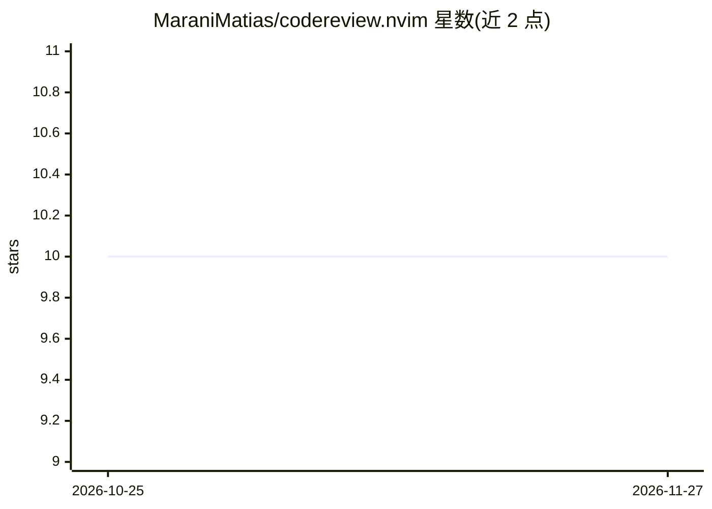

# MaraniMatias/codereview.nvim

⭐ 10 · Lua · MIT · 推送 2026-09-13 · [GitHub](https://github.com/MaraniMatias/codereview.nvim) · 个人维护

**在 Neovim 内对 git diff 做行内代码评审并导出 Markdown**

Neovim 插件，在编辑器内以双栏（资源管理器+diff）形式查看任意 git diff，支持在任意行或可视选区上添加/编辑行内注释（以 virtual text 展示，可用 Telescope 列表），并通过 :w 或 :CodeReviewWrite 将注释导出为 Markdown 文件；提供 table 导出格式（每条注释一行 file|line|side|text），便于后续交给模型处理。要求 Neovim 0.9+ 与 PATH 中的 git，注释仅存于当前会话，关闭即丢失。

## 筛选速览

| 维度 | 判定 | 备注 |
|---|---|---|
| AI 角色 | `ai-enhanced` | 去掉 AI 部分产品仍成立 |
| 许可风险 | `permissive` | MIT |
| 部署形态 | `None` |  |
| 模型依赖 | — | README 未给出锁定关系 |
| 硬件要求 | — | 无带数字的原话,不猜 |
| 安装摩擦 | `low` | 无编译、无系统依赖或容器化 |
| 成熟度 | — | 结构信号不足 |

## 能力要点

- 双栏评审界面：文件浏览器+diff（unified/split），支持 git difftool --dir-diff 一次性审阅全部变更文件
- 行内注释：任意行或可视选区添加，virtual text 展示，]n/[n 跳转，Telescope 列表
- Markdown 导出两种格式：默认分节格式与 table 格式（每注释一行，便于喂给 LLM）
- 词级 diff 高亮、大 diff 分页、未保存注释保护

## 适用场景

- 在 Neovim 里对分支差异逐行写评审意见并留档
- 把评审注释导出为结构化 table 交给 LLM 生成修复建议
- 作为 git difftool 替代 git diff 进行多文件评审

## 场景标签

 · 领域:开发者工具/代码评审

## 证据(README 行号)

> L3: Inline code review on any `git diff`, right inside Neovim, with export to a review file.
> L14: - **Markdown export.** `:w` prompts for a filename; `:CodeReviewWrite` saves to the auto-generated name. A one-line
> L107: **`"table"`** — pipe-separated, one line per note. Compact and easy to feed to a model:

## 星数曲线

2026-10-25 10 → 2026-11-27 10（+0）

---
*卡片 v1 · prompt 1.4 · 生成 2026-11-20 · 置信度 high · 依据 README sha `e22a3a3c715c` · [字段定义](../../DATASET.md)*
