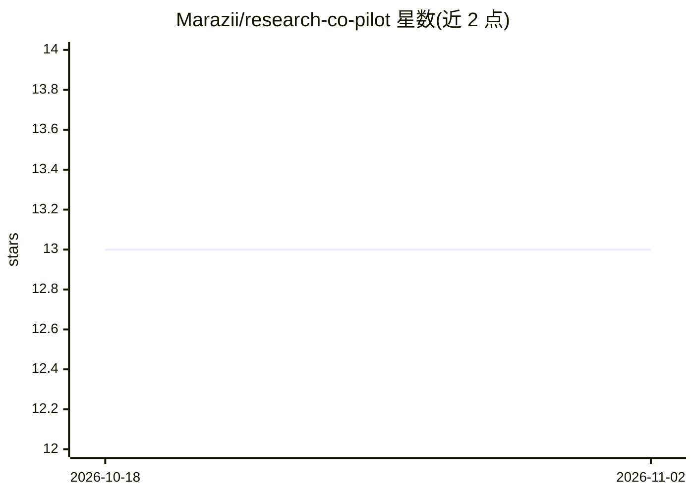

# Marazii/research-co-pilot

⭐ 13 · Shell · MIT · 推送 2026-06-04 · [GitHub](https://github.com/Marazii/research-co-pilot) · 个人维护

**面向科研全流程的 Claude 技能集（14 个技能）**

覆盖研究全生命周期的 Claude 共同驾驶插件：从选题头脑风暴、文献综述、方法设计、伦理审查、问卷设计、数据分析、质性编码，到论文起草、复现设计、基金申请、会议报告、审稿回复、引用格式化与同行评议，共 14 个技能。以两种方式运行：Claude Code 中作为插件（含斜杠命令与子代理），claude.ai 中逐个上传为 Claude Skills。技能间通过共享的项目 vault（research/<project>/ 模板化目录）协作，/research 可按流水线顺序调度，并在需人工环节（收集数据、IRB 批准等）暂停。面向研究生、博士后、教员及应用研究者。

## 筛选速览

| 维度 | 判定 | 备注 |
|---|---|---|
| AI 角色 | `ai-native` | 本体是模型或模型工具 |
| 许可风险 | `permissive` | MIT |
| 部署形态 | `desktop` | 安装包/桌面程序 |
| 模型依赖 | locked-api |  |
| 硬件要求 | — | 无带数字的原话,不猜 |
| 安装摩擦 | `low` | 无编译、无系统依赖或容器化 |
| 成熟度 | `idea` | |

## 能力要点

- 14 个覆盖选题到同行评议的研究生命周期技能
- 技能网络通过模板化项目 vault（00-inbox 至 10-dissemination）共享工件
- /vault audit 扫描文档与 vault 的一致性（样本量漂移、不可解析引用、PII 位置等）
- 流水线模式在人工环节暂停并可从中断处恢复

## 适用场景

- 让 AI 辅助完成论文的文献综述与数据分析
- 整理访谈转录材料并生成带审计线索的质性编码
- 起草基金申请、会议报告与审稿回复信
- 用 /vault audit 在投稿前检查全项目文档一致性

## 场景标签

`科研工具` `数据分析` `AI 写作` · 领域:效率与自动化

## 证据(README 行号)

> L11: A Claude co-pilot for the entire research lifecycle — from picking a question through final peer review. Designed f
> L22: |Stage of research|Skill|Trigger examples|
> L39: Every skill is grounded in research methods literature and refuses common AI failure modes — no fabricated citation

## 星数曲线

2026-10-18 13 → 2026-11-02 13（+0）

---
*卡片 v1 · prompt 1.4 · 生成 2026-10-31 · 置信度 high · 依据 README sha `774078fcac37` · [字段定义](../../DATASET.md)*
