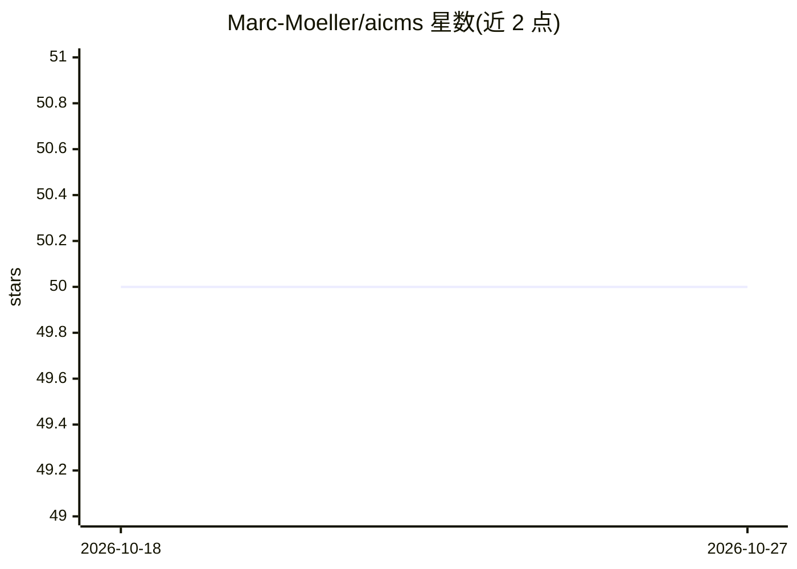

# Marc-Moeller/aicms

⭐ 50 · TypeScript · AGPL-3.0 · 推送 2026-08-21 · [GitHub](https://github.com/Marc-Moeller/aicms) · [官网](https://AICMS.one) · 个人维护

**由 AI agent 对话驱动的开源 CMS，聊天即可建站改站**

AI-first 内容管理系统：用户用自然语言与内置 agent 对话，agent 读取页面、生成经校验的类型化编辑意图并发布到线上站点。内容以带 schema 的 block 组织，每次变更带版本与回滚，操作同时通过 MCP 暴露给外部 agent。技术栈为 Next.js + Hono + Astro + PostgreSQL（Docker 内运行，控制库与内容库分离）。默认经 EvoLink（DeepSeek）调用模型，OpenRouter 为回退，兼容任意 OpenAI 兼容 provider。自托管，AGPL-3.0 许可。

## 筛选速览

| 维度 | 判定 | 备注 |
|---|---|---|
| AI 角色 | `ai-native` | 本体是模型或模型工具 |
| 许可风险 | `viral` | AGPL-3.0 |
| 部署形态 | `self-host` | docker 或自建部署 |
| 模型依赖 | locked-api |  |
| 硬件要求 | — | 无带数字的原话,不猜 |
| 安装摩擦 | `low` | 无编译、无系统依赖或容器化 |
| 成熟度 | — | 结构信号不足 |

## 能力要点

- 聊天驱动的站点编辑：agent 规划、应用并展示 diff
- 类型化 block 内容与校验意图，附带版本与回滚
- 操作经 MCP 暴露给任意 MCP-capable agent
- 内置 starter themes，控制库与内容库双库分离

## 适用场景

- 用对话方式从零建站并持续编辑发布内容
- 让外部 MCP agent 通过类型化工具操作我的站点
- 自托管替代托管型 CMS，掌控数据与后端

## 场景标签

`聊天机器人` · 领域:对话与助手

## 证据(README 行号)

> L3: **AICMS** (AI CMS) is an open-source, AI-first content management system. You manage a website by chatting with an A
> L18: Every other CMS was designed for a human clicking a mouse. AICMS is designed for a future where AI agents do 100% o

## 星数曲线

2026-10-18 50 → 2026-10-27 50（+0）

---
*卡片 v1 · prompt 1.4 · 生成 2026-10-24 · 置信度 high · 依据 README sha `6e21f61da911` · [字段定义](../../DATASET.md)*
