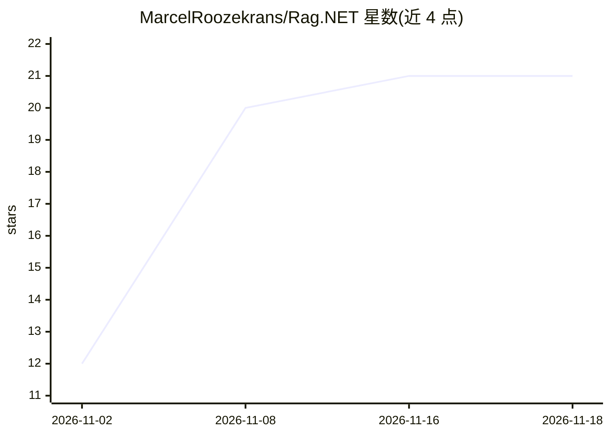

# MarcelRoozekrans/Rag.NET

⭐ 21 · C# · MIT · 推送 2026-11-17 · [GitHub](https://github.com/MarcelRoozekrans/Rag.NET) · [官网](https://marcelroozekrans.github.io/Rag.NET/) · 个人维护

**.NET 开发者的模块化 RAG 流水线库**

面向 .NET 平台的 RAG 流水线库，基于 Microsoft.Extensions.AI 抽象构建，共 74 个 NuGet 包。覆盖文档摄取（解析/分块/嵌入/存储）、多种向量库连接、检索质量模块（GraphRAG、RAPTOR、跨编码器重排、冗余过滤、Corrective RAG）与流式聊天问答。通过依赖注入的 Fluent builder API 组装管线，支持多租户命名管线，并附带 MCP 服务器、REST API、CLI 三种暴露方式与基于嵌入余弦相似度的答案评估包。

## 筛选速览

| 维度 | 判定 | 备注 |
|---|---|---|
| AI 角色 | `ai-ecosystem` | LLM/agent 周边工具 |
| 许可风险 | `permissive` | MIT |
| 部署形态 | `None` |  |
| 模型依赖 | local-ok | 支持本地模型 |
| 硬件要求 | — | 无带数字的原话,不猜 |
| 安装摩擦 | `medium` | 含编译或系统依赖之一 |
| 成熟度 | — | 结构信号不足 |

## 能力要点

- 74 个 NuGet 包组成模块化 RAG 流水线（摄取/分块/向量存储/检索/聊天）
- 检索质量模块：GraphRAG、RAPTOR、ONNX 跨编码器重排、Lost-in-the-Middle 重排
- 18 个数据连接器（Confluence、Jira、Notion、Slack、Microsoft 365 等）与 7 种向量库
- MCP 服务器 / ASP.NET Core REST API / ragnet CLI 三种暴露面

## 适用场景

- 在 .NET 企业应用中搭建文档问答与知识检索管线
- 接入公司内部 Confluence、Jira、Slack 等数据源做 RAG
- 把配置好的 RAG 管线以 MCP 工具或 REST API 暴露给其他系统
- 对 RAG 答案质量做嵌入相似度评分

## 场景标签

`RAG` · 领域:知识与检索

## 证据(README 行号)

> L14: A modular RAG (Retrieval-Augmented Generation) pipeline library for .NET. Built on Microsoft.Extensions.AI abstract
> L63: - **DI-first** - Fluent builder API with `Microsoft.Extensions.DependencyInjection`
> L286: The samples/Rag.NET.Sample project is an interactive console app that demonstrates the full pipeline. It supports 

## 星数曲线

2026-11-02 12 → 2026-11-18 21（+9）

---
*卡片 v1 · prompt 1.4 · 生成 2026-11-18 · 置信度 high · 依据 README sha `02e66cfb4b45` · [字段定义](../../DATASET.md)*
