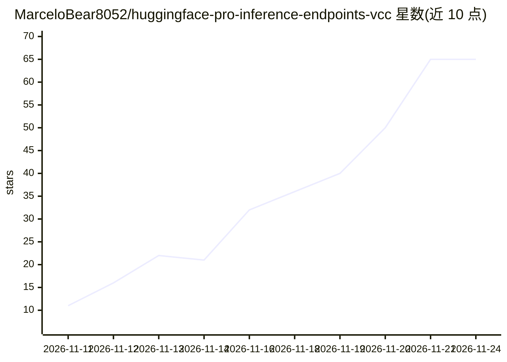

# MarceloBear8052/huggingface-pro-inference-endpoints-vcc

⭐ 86 · 推送 2026-11-11 · [GitHub](https://github.com/MarceloBear8052/huggingface-pro-inference-endpoints-vcc) · [官网](https://app.coregold.io/signup?invite_code=ADvlj9b) · 个人维护 · 中文 README

**CoreGold 虚拟卡开通 Hugging Face Pro 与推理端点的付费指南**

一篇以 README 形式发布的付费流程指南：面向订阅 Hugging Face Pro（$9/月）或开通按小时租用 GPU 的 Inference Endpoints 的开发者，指导其注册 CoreGold、以 USDT（TRC20/ERC20）充值、签发带单卡消费限额的欧美商业虚拟卡（VCC），并绑定到 Hugging Face Billing 页面完成扣费。内容包含被 Stripe 拒付原因的拆解、实体信用卡与 VCC 的对比表、三步配置流程及卡片限额防超额说明。仓库不含代码，末尾附推广链接与哈希字符串。

## 筛选速览

| 维度 | 判定 | 备注 |
|---|---|---|
| AI 角色 | `ai-knowledge` | 知识聚合/清单类 |
| 许可风险 | `none` | — |
| 部署形态 | `None` |  |
| 模型依赖 | — | README 未给出锁定关系 |
| 硬件要求 | — | 无带数字的原话,不猜 |
| 安装摩擦 | `low` | 无编译、无系统依赖或容器化 |
| 成熟度 | — | 结构信号不足 |

## 能力要点

- 指导用 USDT 充值并签发带硬限额的商业虚拟卡
- 覆盖 Hugging Face Billing 绑卡与账单地址填写步骤
- 提供实体信用卡与 VCC 的风险维度对比表

## 适用场景

- 遇到 Hugging Face 绑卡被拒时寻找替代结算方式
- 为按小时计费的 GPU 推理端点设置支出上限

## 场景标签

 · 领域:开发者服务/支付

## 证据(README 行号)

> L2: ⚡ 2026 实战指南：用 CoreGold 商业 VCC 搞定 Hugging Face Pro 与私有推理端点结算=
> L31: ### 第一步：USDT 链上注资（1 分钟）

## 星数曲线

2026-11-11 11 → 2026-11-24 65（+54）

---
*卡片 v1 · prompt 1.4 · 生成 2026-11-18 · 置信度 mid · 依据 README sha `d75a6a2096b1` · [字段定义](../../DATASET.md)*
