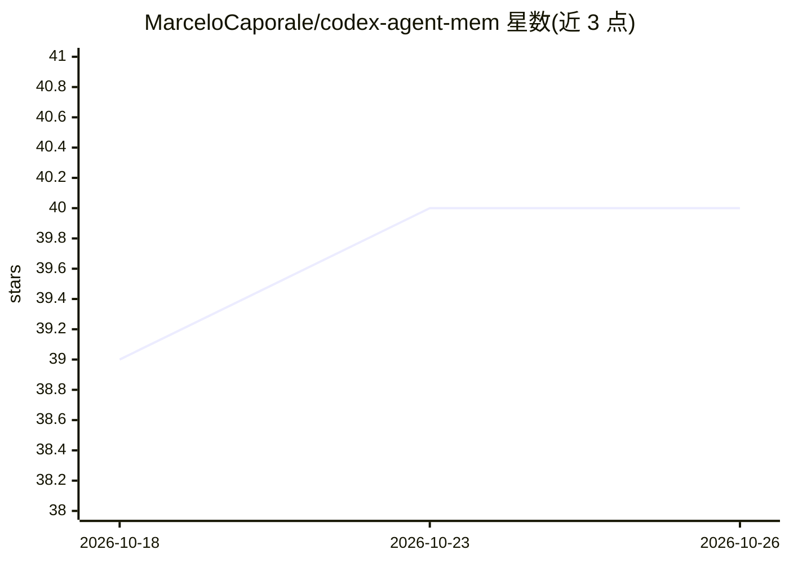

# MarceloCaporale/codex-agent-mem

⭐ 40 · Python · Apache-2.0 · 推送 2026-05-07 · [GitHub](https://github.com/MarceloCaporale/codex-agent-mem) · [官网](https://marcelocaporale.github.io/codex-agent-mem/) · 个人维护 · 中文 README

**本地优先的 MCP 记忆层：为 AI 编码代理保存可审计项目记忆**

面向 MCP 兼容代理（Codex CLI/Desktop、Claude Code、Gemini CLI、Qwen Code 等）的持久化本地记忆层：将项目连续性压缩为小型上下文包（fixture 中约 95% token 削减），通过 mem_context_pack、mem_search 等工具按需拉取，支持快照、会话感知检索、known_pack_hash 去重与 --read-only 审计模式。数据全部存于本地 SQLite+FTS5，无外部记忆服务器。默认 SQLite 为明文，不作密钥库使用。

## 筛选速览

| 维度 | 判定 | 备注 |
|---|---|---|
| AI 角色 | `ai-ecosystem` | LLM/agent 周边工具 |
| 许可风险 | `permissive` | Apache-2.0 |
| 部署形态 | `None` |  |
| 模型依赖 | local-ok | 支持本地模型 |
| 硬件要求 | — | 无带数字的原话,不猜 |
| 安装摩擦 | `low` | 无编译、无系统依赖或容器化 |
| 成熟度 | `idea` | |

## 能力要点

- SQLite+FTS5 本地存储，上下文压缩包与 token 节省统计
- 按需拉取式记忆检索，无 session-start 注入与 stop-hook 摘要
- --read-only 审计模式与 not_modified 短路去重
- 跨运行时验证矩阵（Codex/Gemini/Claude Code/Qwen/DeepSeek/Minimax/Kimi）

## 适用场景

- 让 Codex 或 Claude Code 在跨会话时保留项目记忆、减少重复上下文
- 代理工作流中做上下文压缩与未变更包去重
- 以只读模式审计代理的持久化记忆内容

## 场景标签

`Agent 记忆` · 领域:Agent 开发

## 证据(README 行号)

> L3:  codex-agent-mem: persistent local memory for MCP clients
> L11: `codex-agent-mem` keeps durable project memory outside the model runtime, compresses continuity into smaller workin
> L15: Born for Codex and GPT workflows, `codex-agent-mem` has grown into a portable MCP memory layer for MCP-compatible r

## 星数曲线

2026-10-18 39 → 2026-10-26 40（+1）

---
*卡片 v1 · prompt 1.4 · 生成 2026-10-25 · 置信度 high · 依据 README sha `069ef3230f2f` · [字段定义](../../DATASET.md)*
