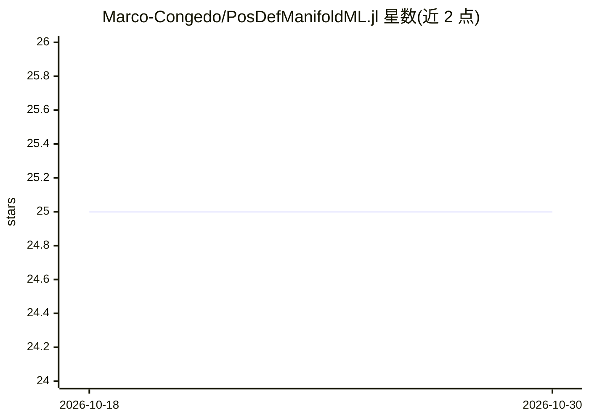

# Marco-Congedo/PosDefManifoldML.jl

⭐ 25 · Julia · NOASSERTION · 推送 2026-06-22 · [GitHub](https://github.com/Marco-Congedo/PosDefManifoldML.jl) · 组织维护

**正定矩阵黎曼流形上的机器学习分类 Julia 包**

基于 PosDefManifold.jl、GLMNet.jl 与 LIBSVM.jl 的 Julia 机器学习包，用于对实或复正定矩阵构成的黎曼流形上的数据做分类。支持直接在流形上运行的 MDM 分类器，以及切空间中的弹性网逻辑回归（含 Ridge/Lasso）与多种 SVM 分类器；切空间模型也可用于传统欧氏特征向量。作者来自法国 CNRS 与格勒诺布尔阿尔卑斯大学，面向科研用户，通过 Julia REPL 安装。

## 筛选速览

| 维度 | 判定 | 备注 |
|---|---|---|
| AI 角色 | `ai-native` | 本体是模型或模型工具 |
| 许可风险 | `none` | NOASSERTION |
| 部署形态 | `None` |  |
| 模型依赖 | — | README 未给出锁定关系 |
| 硬件要求 | — | 无带数字的原话,不猜 |
| 安装摩擦 | `low` | 无编译、无系统依赖或容器化 |
| 成熟度 | `idea` | |

## 能力要点

- 黎曼 MDM 分类器直接在正定矩阵流形上运行
- 切空间中的弹性网逻辑回归（Ridge/Lasso）与多种 SVM
- 切空间模型可处理传统欧氏特征向量

## 适用场景

- 脑机接口等正定矩阵（如协方差）特征数据的分类
- 在黎曼流形或切空间两种范式下做分类实验
- 作为 GLMNet.jl 与 LIBSVM.jl 模型的统一接口使用

## 场景标签

`科研工具` · 领域:学习与行业

## 证据(README 行号)

> L3: **PosDefManifoldML** is a **Julia** package for classifying data in the **Riemannian manifolds** **P** of real or co
> L5: Machine learning (ML) in **P** can either operate directly on the manifold, which requires dedicated Riemannian meth

## 星数曲线

2026-10-18 25 → 2026-10-30 25（+0）

---
*卡片 v1 · prompt 1.4 · 生成 2026-10-27 · 置信度 high · 依据 README sha `1fbe06eb1dc7` · [字段定义](../../DATASET.md)*
