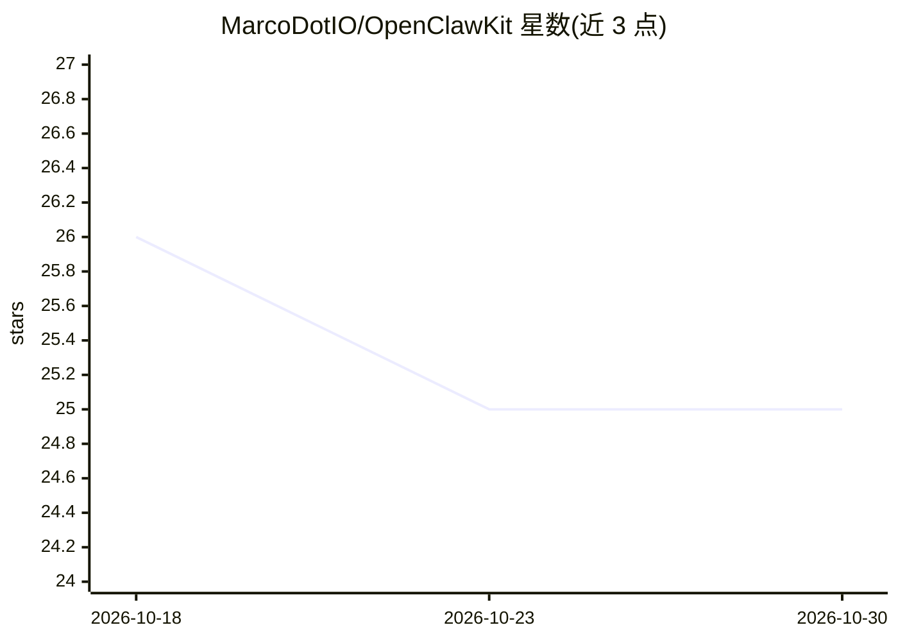

# MarcoDotIO/OpenClawKit

⭐ 25 · Swift · MIT · 推送 2026-10-07 · [GitHub](https://github.com/MarcoDotIO/OpenClawKit) · 个人维护

**Swift SDK：在 Apple 平台与 Linux 上构建本地 OpenClaw 式 AI agent**

以 SwiftPM 多产品形式提供的 OpenClaw 式 agent 开发工具包：覆盖协议、核心运行时、网关（进程内 GatewayServer 与 OpenClaw 协议 v4 客户端）、agent 工具调用循环、插件、通道适配、记忆（BM25/嵌入/MMR）、媒体、模型路由与 MCP 客户端；支持 OpenAI Platform/ChatGPT OAuth、Anthropic、Gemini/Vertex、xAI、Bedrock、Ollama 及 Apple Foundation Models 等提供商路由，并提供 SwiftUI 聊天 UI、App Intents、离线转录缓存等 Apple 专属模块。跨平台模块兼容 Linux Swift 6.2；Apple 27 API 通过编译与可用性门控保持旧系统可启动。

## 筛选速览

| 维度 | 判定 | 备注 |
|---|---|---|
| AI 角色 | `ai-ecosystem` | LLM/agent 周边工具 |
| 许可风险 | `permissive` | MIT |
| 部署形态 | `self-host` | docker 或自建部署 |
| 模型依赖 | — | README 未给出锁定关系 |
| 硬件要求 | — | 无带数字的原话,不猜 |
| 安装摩擦 | `low` | 无编译、无系统依赖或容器化 |
| 成熟度 | — | 结构信号不足 |

## 能力要点

- 分层 SwiftPM 产品：协议/运行时/网关/agent/插件/通道/记忆/模型/MCP 等
- 进程内网关与 OpenClaw 协议 v4 网关客户端
- 跨 OpenAI、Anthropic、Gemini、xAI、Bedrock、Ollama、Apple Foundation Models 的提供商路由
- Sign in with ChatGPT：以用户 ChatGPT 订阅运行 agent，无需 API key

## 适用场景

- 在 iOS/macOS/visionOS 应用中嵌入带会话与转录的本地 agent
- Swift 应用接入远程 OpenClaw 网关并复用聊天 UI
- Linux 服务中复用跨平台运行时模块构建 agent 服务

## 场景标签

`Agent 框架` `Agent 记忆` · 领域:Agent 开发

## 证据(README 行号)

> L11: OpenClawKit is a Swift-native SDK for building OpenClaw-style agents, channels, and app integrations on Apple platf
> L20: - provider routing across OpenAI (Platform and ChatGPT/Codex OAuth), OpenAI-compatible, Anthropic, Google Gemini/Ve

## 星数曲线

2026-10-18 26 → 2026-10-30 25（-1）

---
*卡片 v1 · prompt 1.4 · 生成 2026-10-27 · 置信度 mid · 依据 README sha `c3147ea4f27c` · [字段定义](../../DATASET.md)*
