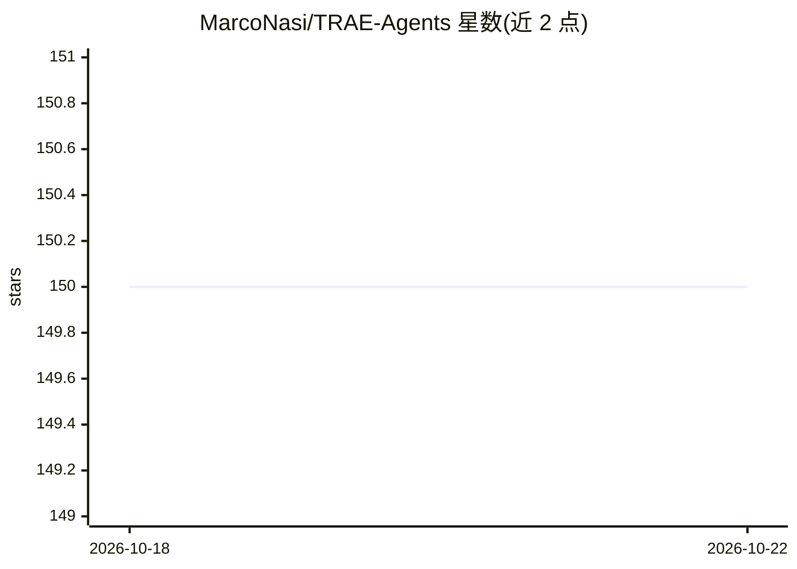

# MarcoNasi/TRAE-Agents

⭐ 150 · NOASSERTION · 推送 2026-08-04 · [GitHub](https://github.com/MarcoNasi/TRAE-Agents) · 个人维护 · 中文 README

**TRAE IDE 专用专家 Agent 提示词合集（已停止维护）**

面向 TRAE IDE 的 agent 提示词合集：按核心智能、前端、后端、自动化/QA、DevOps、游戏、分析与 MVP 等 8 大类组织约 50+ 个专家 agent，另有覆盖 C/C++/Java/Python/Go/Rust 等语言的全语言库（ALL_LANGUAGE.md），每个条目提供一键导入链接。README 顶部声明：作者已停止对 TRAE 的全部支持并转向自有平台 YecoAI，仓库仅作参考保留，不再更新、修复问题或接受 TRAE 相关 PR/issue，允许并鼓励 fork。安装方式为在 TRAE 中点击列表内的导入链接。

## 筛选速览

| 维度 | 判定 | 备注 |
|---|---|---|
| AI 角色 | `ai-knowledge` | 知识聚合/清单类 |
| 许可风险 | `none` | NOASSERTION |
| 部署形态 | `None` |  |
| 模型依赖 | — | README 未给出锁定关系 |
| 硬件要求 | — | 无带数字的原话,不猜 |
| 安装摩擦 | `low` | 无编译、无系统依赖或容器化 |
| 成熟度 | — | 结构信号不足 |

## 能力要点

- 8 大类别约 50+ 个专家 agent，含代码优化、安全审计、渗透测试、SEO 等
- 提供 C/C++/Java/Python/Go/Rust 等语言的全语言 agent 库
- 每条 agent 附 TRAE 内一键导入链接
- 仓库已明确声明停止维护，仅作参考保留并允许 fork

## 适用场景

- 为 TRAE IDE 按领域查找现成专家 agent
- fork 后自行维护或改造 agent 提示词
- 参考 HOW_I_HAVE_CREATED.md 了解 agent 构建方法

## 场景标签

`提示工程` `精选清单` · 领域:Agent 开发

## 证据(README 行号)

> L5: A powerful collection of **expert-level TRAE Agents**, designed to enhance every stage of modern software developmen
> L43: |Category|Agent Name|Info|Install|Install CN Only|
> L105: Looking for language-specific TRAE agents (C, C++, C#, Java, Kotlin, Python, Go, Rust, and more)?

## 星数曲线

2026-10-18 150 → 2026-10-22 150（+0）

---
*卡片 v1 · prompt 1.4 · 生成 2026-10-22 · 置信度 high · 依据 README sha `26820fde14bc` · [字段定义](../../DATASET.md)*
