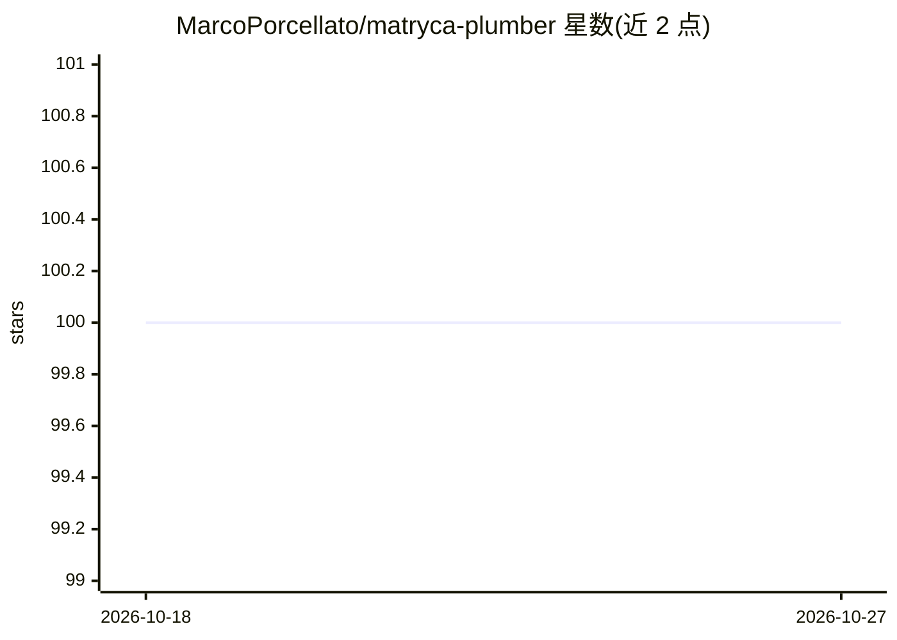

# MarcoPorcellato/matryca-plumber

⭐ 100 · Python · Apache-2.0 · 推送 2026-10-26 · [GitHub](https://github.com/MarcoPorcellato/matryca-plumber) · 个人维护

**面向人类与 AI agent 共用的 Logseq 本地记忆管理守护进程**

直接读写磁盘上的 Logseq Markdown 知识图谱（不依赖云 API 或 Logseq API），为人类和 agent 提供同一受治理的访问平面：CLI 与 MCP 暴露结构化图操作，外部 Shadow DB（FTS5）加速搜索与子树读取，Shadow 不可用时回退到 Markdown BM25；写入走解析器感知的块级变更，配乐观并发控制、页锁与严格只读模式，拒绝过期写入。要求 Python 3.12+ 和一个 Logseq OG graph，通过 uvx/uv 或 PyPI 安装；不定义也不要求图数据库、向量库或嵌入模型。

## 筛选速览

| 维度 | 判定 | 备注 |
|---|---|---|
| AI 角色 | `ai-ecosystem` | LLM/agent 周边工具 |
| 许可风险 | `permissive` | Apache-2.0 |
| 部署形态 | `library` | 以包/库形式分发 |
| 模型依赖 | — | README 未给出锁定关系 |
| 硬件要求 | — | 无带数字的原话,不猜 |
| 安装摩擦 | `low` | 无编译、无系统依赖或容器化 |
| 成熟度 | `idea` | |

## 能力要点

- Markdown 为唯一权威数据源，Shadow DB 仅作可丢弃缓存并可回退到 BM25
- CLI/MCP 提供结构化图操作，含块级检索、按深度/节点数/字节数限界
- 乐观并发控制、页锁、dry-run 与 Strict Read Only 保护人类笔记不被 agent 覆写
- 本地优先运行，无需云 API key

## 适用场景

- 让 AI agent 安全读写我的 Logseq 笔记而不损坏数据
- 为 agent 提供块粒度的知识检索以缩减上下文占用
- 在只读模式下让 agent 利用缓存加速查询但禁止改动图谱

## 场景标签

`知识图谱` `Agent 记忆` · 领域:Agent 开发

## 证据(README 行号)

> L79: **Local-first human/agentic memory inspired from Logseq OG and maintenance for Logseq.**
> L215: |**Safe agent access**|CLI and MCP expose structured graph operations instead of ad hoc file edits.|
> L219: |**Local-first operation**|The graph stays on disk; local inference works without a cloud API key.|

## 星数曲线

2026-10-18 100 → 2026-10-27 100（+0）

---
*卡片 v1 · prompt 1.4 · 生成 2026-10-23 · 置信度 high · 依据 README sha `361277fc82b3` · [字段定义](../../DATASET.md)*
