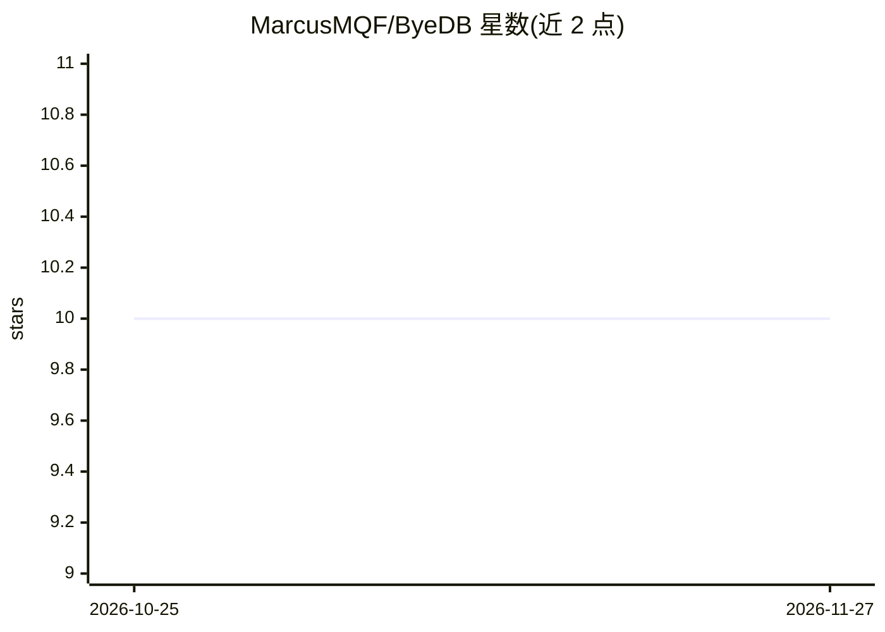

# MarcusMQF/ByeDB

⭐ 10 · TypeScript · GPL-3.0 · 推送 2026-03-02 · [GitHub](https://github.com/MarcusMQF/ByeDB) · [官网](https://bye-db.vercel.app/) · 个人维护

**面向非技术用户的自然语言查数据库与可视化聊天平台**

ByeDB.AI 是一个多智能体架构的自然语言转 SQL 平台，前端为 Next.js 聊天界面，后端为 FastAPI，本地数据库处理基于 SQLite。系统包含查询、校验、教学、安全、性能五个 Agent，通过 OpenAI GPT 与 Google Gemini 双模型编排生成 SQL，支持 CSV/Excel 上传、图表可视化、多格式导出、会话记忆，写操作与破坏性查询需人工确认。提供 Ask 模式（仅解释不执行）与 Agent 模式（直接执行 SQL）。要求 Python 3.8+ 与 Node 18+。

## 筛选速览

| 维度 | 判定 | 备注 |
|---|---|---|
| AI 角色 | `ai-native` | 本体是模型或模型工具 |
| 许可风险 | `viral` | GPL-3.0 |
| 部署形态 | `library` | 以包/库形式分发 |
| 模型依赖 | — | README 未给出锁定关系 |
| 硬件要求 | — | 无带数字的原话,不猜 |
| 安装摩擦 | `low` | 无编译、无系统依赖或容器化 |
| 成熟度 | — | 结构信号不足 |

## 能力要点

- 五个专门化 Agent（查询/校验/教学/安全/性能）协作的多智能体架构
- OpenAI GPT 与 Google Gemini 双模型智能路由编排
- Ask/Agent 双模式：可仅解释不执行 SQL，写操作强制确认
- CSV/Excel 上传、图表可视化与多格式一键导出

## 适用场景

- 不会 SQL 的业务人员用自然语言查询数据库并生成图表
- 上传 CSV/Excel 在聊天中直接做数据分析并导出结果
- 通过 AI 对生成 SQL 的实时讲解学习 SQL

## 场景标签

`多智能体` `数据分析` · 领域:Agent 开发

## 证据(README 行号)

> L16: ByeDB.AI redefines autonomous database intelligence, leveraging a sophisticated multi-agent architecture and advanc
> L24: - **Query Agent**: Specialized in natural language interpretation and SQL generation
> L114: 5. **Natural Language Processing** – Convert user questions to SQL queries

## 星数曲线

2026-10-25 10 → 2026-11-27 10（+0）

---
*卡片 v1 · prompt 1.4 · 生成 2026-11-20 · 置信度 high · 依据 README sha `3572c434480b` · [字段定义](../../DATASET.md)*
