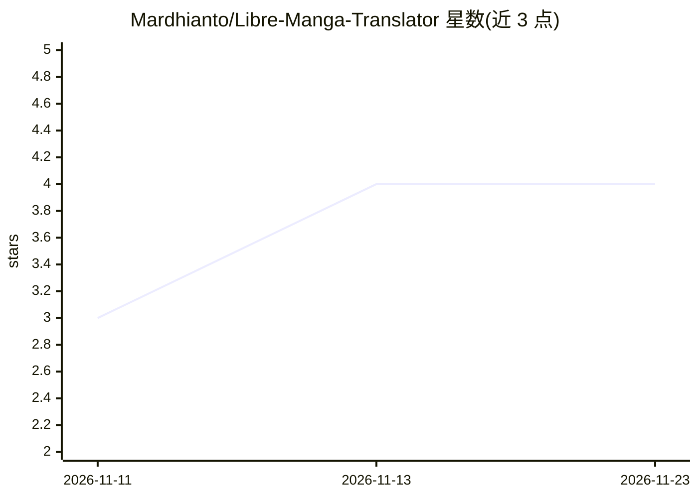

# Mardhianto/Libre-Manga-Translator

⭐ 4 · TypeScript · NOASSERTION · 推送 2026-11-19 · [GitHub](https://github.com/Mardhianto/Libre-Manga-Translator) · [官网](https://libre.mangatl.asia) · 个人维护

**漫画读者浏览器扩展：本地/云端翻译漫画页**

浏览器扩展（Firefox/Chrome），在漫画页面上完成气泡检测、OCR、翻译与图像修补的一体化流程。提供三种模式：默认 Local 模式经 WebLLM 在本机 GPU 上运行 LLM（Llama-3.2-1B 至 Qwen3.5-9B 等可选），检测用 RT-DETR-v2 或 Comic Text Detector，OCR 可选 PaddleOCR/PP-OCRv6 Manga/Manga-OCR/Pororo；Gemini 模式将整页图像发送至 Google API；API 模式连接自托管 LLM 服务器仅发送提取文本。首次下载权重约 0.8–4 GB，之后可完全离线。

## 筛选速览

| 维度 | 判定 | 备注 |
|---|---|---|
| AI 角色 | `ai-native` | 本体是模型或模型工具 |
| 许可风险 | `none` | NOASSERTION |
| 部署形态 | `None` |  |
| 模型依赖 | local-ok | 支持本地模型 |
| 硬件要求 | — | 无带数字的原话,不猜 |
| 安装摩擦 | `low` | 无编译、无系统依赖或容器化 |
| 成熟度 | — | 结构信号不足 |

## 能力要点

- 三种翻译模式：本机 WebLLM、Gemini 云端、自托管 LLM 服务器
- 可选 OCR 引擎：PaddleOCR、PP-OCRv6 Manga、Manga-OCR、Pororo（韩文）
- 脚本识别门过滤拟声词与非对白区域，可交互修正气泡框
- 自适应修补阶梯：planar fill/bilateral/Telea，可选 LaMa 神经重绘

## 适用场景

- 在浏览器里直接阅读并翻译日文/韩文漫画页
- 不联网上传图像的本机翻译阅读流程
- 自建 LLM 服务器接入翻译漫画文本
- 低配设备上改用 Gemini 云端模式翻译

## 场景标签

`OCR` `图像视频处理` · 领域:感知与多模态

## 证据(README 行号)

> L15: Translate manga in your browser with freedom to choose how. Run everything on your device, offload to the cloud, or
> L27: **Local Mode** (default, fully local) runs everything on-device. A WebLLM model (Llama-3.2-1B, Qwen3.5-0.8B, Gemma2
> L31: **API Mode** (self-hosted) connects to your own LLM server (Ollama, LM Studio, or any OpenAI-compatible endpoint) r

## 星数曲线

2026-11-11 3 → 2026-11-23 4（+1）

---
*卡片 v1 · prompt 1.4 · 生成 2026-11-21 · 置信度 high · 依据 README sha `6bd5354323b0` · [字段定义](../../DATASET.md)*
