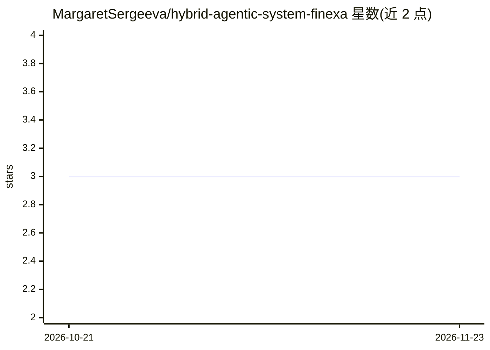

# MargaretSergeeva/hybrid-agentic-system-finexa

⭐ 3 · 推送 2026-10-23 · [GitHub](https://github.com/MargaretSergeeva/hybrid-agentic-system-finexa) · [官网](margaretsergeeva.github.io/Finexa_Demo) · 个人维护

**面向金融科技公司的 12 周混合式 Agentic 系统试点项目文档集**

THRIVE AI 项目管理毕业项目（capstone winner）成果：为一家支付领域 fintech 设计的 12 周混合式 Agentic 系统试点，包含项目简报、干系人 RACI、风险登记册、监控计划等完整交付文档，以及 11 张表的 BigQuery 数据模式与可交互在线原型。系统含 4 个 AI 命令与自然语言分析入口，设 3 道人工审批门禁、加权公式优先级、DLP 去标识化与 GDPR/EU AI Act 合规设计。仓库以文档与原型为主，非可运行软件包。

## 筛选速览

| 维度 | 判定 | 备注 |
|---|---|---|
| AI 角色 | `ai-knowledge` | 知识聚合/清单类 |
| 许可风险 | `none` | — |
| 部署形态 | `None` |  |
| 模型依赖 | — | README 未给出锁定关系 |
| 硬件要求 | — | 无带数字的原话,不猜 |
| 安装摩擦 | `low` | 无编译、无系统依赖或容器化 |
| 成熟度 | — | 结构信号不足 |

## 能力要点

- 四个 AI 命令（反馈处理/记录、机会优先级、用户故事起草）加 /ask-data 自然语言分析
- 三道强制人工审批门禁的人机协同设计
- 优先级采用透明加权公式，不由模型生成
- Google Cloud DLP 去标识化、GDPR 审查、EU AI Act 低风险分类等合规设计

## 适用场景

- 参考多渠道客户反馈汇聚与积压项优先级的项目方案
- 了解带人工门禁与审计追踪的 agentic 系统治理设计
- 查阅试点项目的风险登记册与监控计划文档

## 场景标签

`工作流自动化` `教程课程` · 领域:效率与自动化

## 证据(README 行号)

> L4: 12-Week Hybrid Agentic System Pilot
> L6: THRIVE AI Project Management program (Kiron Open Higher Education), 2026. Business case provided by Mollie.
> L36: - **A complete delivery package:** Project Brief, Stakeholder Map & RACI, Risk Mitigation Analysis and Monitoring P

## 星数曲线

2026-10-21 3 → 2026-11-23 3（+0）

---
*卡片 v1 · prompt 1.4 · 生成 2026-11-22 · 置信度 high · 依据 README sha `c9618bf2ac41` · [字段定义](../../DATASET.md)*
