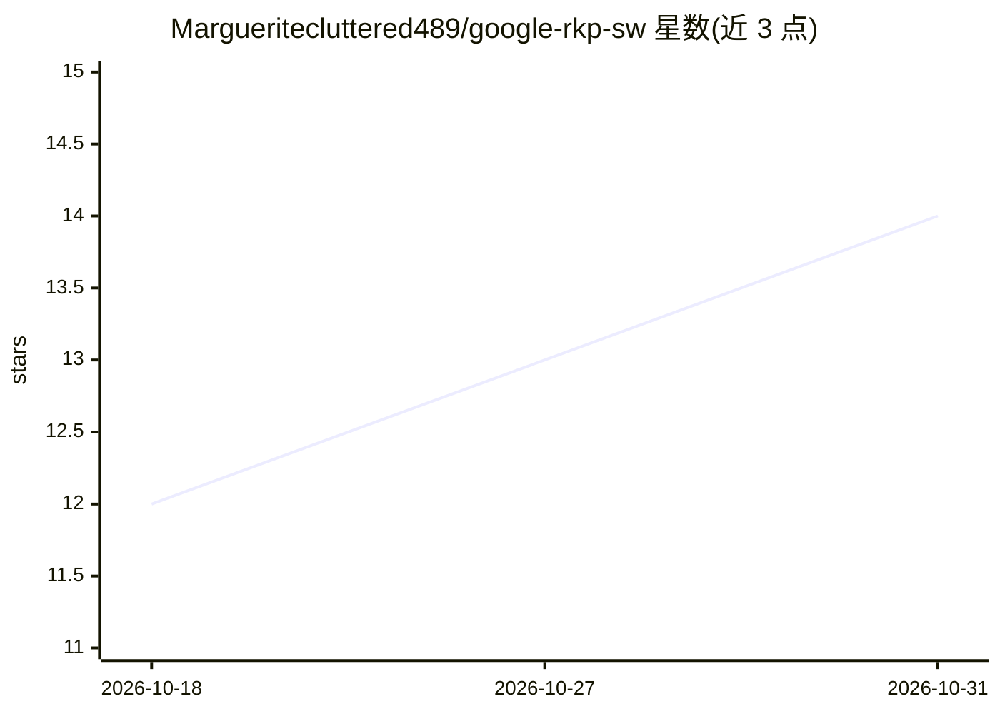

# Margueritecluttered489/google-rkp-sw

⭐ 14 · Python · Apache-2.0 · 推送 2026-10-14 · [GitHub](https://github.com/Margueritecluttered489/google-rkp-sw) · 个人维护

**Windows 桌面工具：软件方式执行 Android 远程密钥供给并导出 keybox.xml**

面向需要在无设备 TEE 环境下执行 Android 远程密钥供给（RKP）流程的用户：读取 32 字节 CDI_Leaf 种子，生成 AuthenticatedRequest CSR，连接 Google 生产 RKP 服务器获取供给数据，并将结果写出为 keybox.xml 供下游密钥证明工具使用。以 Windows 可执行程序形式分发（ZIP 下载解压运行），需要网络访问，种子数据需按敏感私钥材料保管。README 未说明软件实现细节或许可信息。

## 筛选速览

| 维度 | 判定 | 备注 |
|---|---|---|
| AI 角色 | `ai-enhanced` | 去掉 AI 部分产品仍成立 |
| 许可风险 | `permissive` | Apache-2.0 |
| 部署形态 | `desktop` | 安装包/桌面程序 |
| 模型依赖 | — | README 未给出锁定关系 |
| 硬件要求 | — | 无带数字的原话,不猜 |
| 安装摩擦 | `low` | 无编译、无系统依赖或容器化 |
| 成熟度 | — | 结构信号不足 |

## 能力要点

- 以软件路径替代设备端 TEE 执行 Android RKP 流程
- 生成 AuthenticatedRequest CSR 并连接 Google 生产 RKP 服务器
- 输出 keybox.xml 供 Android KeyMint 密钥证明使用
- 支持更换 CDI_Leaf 种子重复运行并生成日志

## 适用场景

- 在无 TEE 设备环境下生成 Android 密钥证明所需的供给数据
- 为下游证明工具准备 keybox.xml 文件
- 为 Android KeyMint 导出证明数据

## 场景标签

 · 领域:Android 安全/密钥供给

## 证据(README 行号)

> L7: google-rkp-sw is a Windows app for Android key provisioning. It helps create the request data used for Android attes
> L84: This replaces the on-device TEE path with a software path.

## 星数曲线

2026-10-18 12 → 2026-10-31 14（+2）

---
*卡片 v1 · prompt 1.4 · 生成 2026-10-31 · 置信度 mid · 依据 README sha `b684d9dbc7a8` · [字段定义](../../DATASET.md)*
