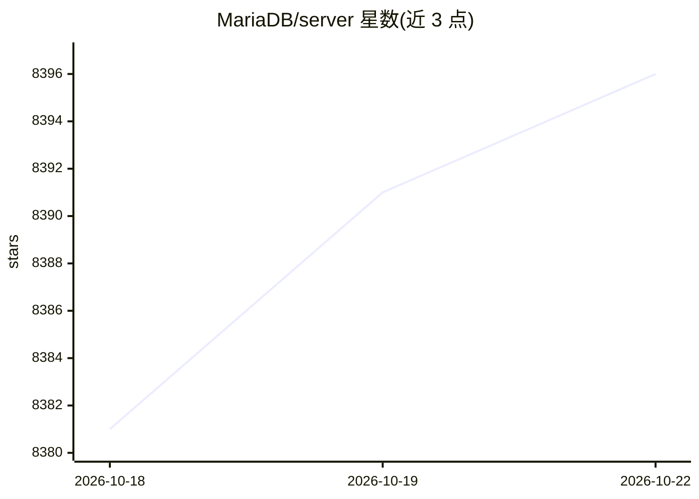

# MariaDB/server

⭐ 8,396 · C++ · GPL-2.0 · 推送 2026-10-21 · [GitHub](https://github.com/MariaDB/server) · [官网](https://mariadb.org) · 组织维护

**开源关系型数据库：MySQL 兼容分支，含原生向量检索**

由原 MySQL 开发者发起的社区开发关系型数据库，由 MariaDB 基金会与 MariaDB plc 维护，保持 MySQL 线协议与语法兼容并提供 Oracle SQL 模式。功能包括内置 VECTOR 数据类型与 HNSW 近似最近邻索引（11.8 起免扩展）、InnoDB/Aria/MyRocks/ColumnStore 等可插拔存储引擎、Galera 同步多主集群与多种复制方式、CTE/窗口函数/系统版本表、GIS 与全文检索、基于角色的访问控制与加密。采用年度 LTS 加季度滚动发布模型，GPLv2 许可。

## 筛选速览

| 维度 | 判定 | 备注 |
|---|---|---|
| AI 角色 | `ai-enhanced` | 去掉 AI 部分产品仍成立 |
| 许可风险 | `viral` | GPL-2.0 |
| 部署形态 | `None` |  |
| 模型依赖 | — | README 未给出锁定关系 |
| 硬件要求 | — | 无带数字的原话,不猜 |
| 安装摩擦 | `low` | 无编译、无系统依赖或容器化 |
| 成熟度 | — | 结构信号不足 |

## 能力要点

- 内置 VECTOR 类型与 HNSW 近似最近邻索引（11.8 起，无需扩展）
- 可插拔存储引擎：InnoDB、Aria、MyRocks、ColumnStore、Spider、S3 等
- MySQL 线协议与语法兼容，含 Oracle SQL 模式（PL/SQL 风格存储例程）
- Galera 同步多主集群与异步/半同步/并行复制

## 适用场景

- 作为现有 MySQL 部署的迁移目标运行事务型业务
- 用内置向量检索支撑语义搜索类应用
- 通过 Galera 集群与多级复制构建高可用数据库

## 场景标签

`向量数据库` · 领域:知识与检索

## 证据(README 行号)

> L3: MariaDB Server is one of the most widely deployed open source relational
> L17: * **Native vector search**. A built-in VECTOR data type with approximate
> L18:  nearest-neighbour indexing (HNSW), available since MariaDB 11.8 with

## 星数曲线

2026-10-18 8,381 → 2026-10-22 8,396（+15）

---
*卡片 v1 · prompt 1.4 · 生成 2026-10-20 · 置信度 high · 依据 README sha `d5d4d1418a1c` · [字段定义](../../DATASET.md)*
