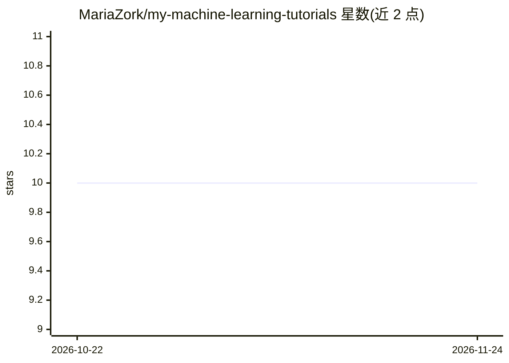

# MariaZork/my-machine-learning-tutorials

⭐ 10 · Jupyter Notebook · 推送 2026-04-06 · [GitHub](https://github.com/MariaZork/my-machine-learning-tutorials) · 个人维护

**面向学习者的机器学习应用 Jupyter notebook 教程集**

以 Jupyter notebook 形式组织的机器学习教程与项目合集，每个项目独立文件夹，包含 notebook、数据与脚本。覆盖 LLM 微调（LoRA 微调 Qwen2.5-3B 于法律语料）、时间序列预测（LSTM 交通流量）、计算机视觉（ResNet 病理图像分类）、NLP（文本生成、URL 检测）、图神经网络（比特币交易欺诈检测）等方向。要求 Python 3.10+、PyTorch 2.0+ 与 Jupyter 环境。

## 筛选速览

| 维度 | 判定 | 备注 |
|---|---|---|
| AI 角色 | `ai-knowledge` | 知识聚合/清单类 |
| 许可风险 | `none` | — |
| 部署形态 | `None` |  |
| 模型依赖 | — | README 未给出锁定关系 |
| 硬件要求 | — | 无带数字的原话,不猜 |
| 安装摩擦 | `low` | 无编译、无系统依赖或容器化 |
| 成熟度 | — | 结构信号不足 |

## 能力要点

- 每个项目独立文件夹，含 notebook、数据与脚本
- 覆盖 LLM 微调、时间序列、CV、NLP、GNN 多个方向
- LLM 项目含数据准备、训练、评估（ROUGE/BERTScore）与推理全流程

## 适用场景

- 按教程 notebook 学习 LoRA 微调 LLM 的完整流程
- 参考 LSTM/ResNet/GNN 项目实现复现类似分类与预测任务
- 学习从开放数据准备数据集到评估的机器学习工程实践

## 场景标签

`教程课程` `微调` · 领域:学习与行业

## 证据(README 行号)

> L3: A collection of hands-on machine learning tutorials and projects - from classical ML to LLM engineering. Each projec
> L26: ## Requirements

## 星数曲线

2026-10-22 10 → 2026-11-24 10（+0）

---
*卡片 v1 · prompt 1.4 · 生成 2026-11-20 · 置信度 high · 依据 README sha `8386ec3bd9e8` · [字段定义](../../DATASET.md)*
