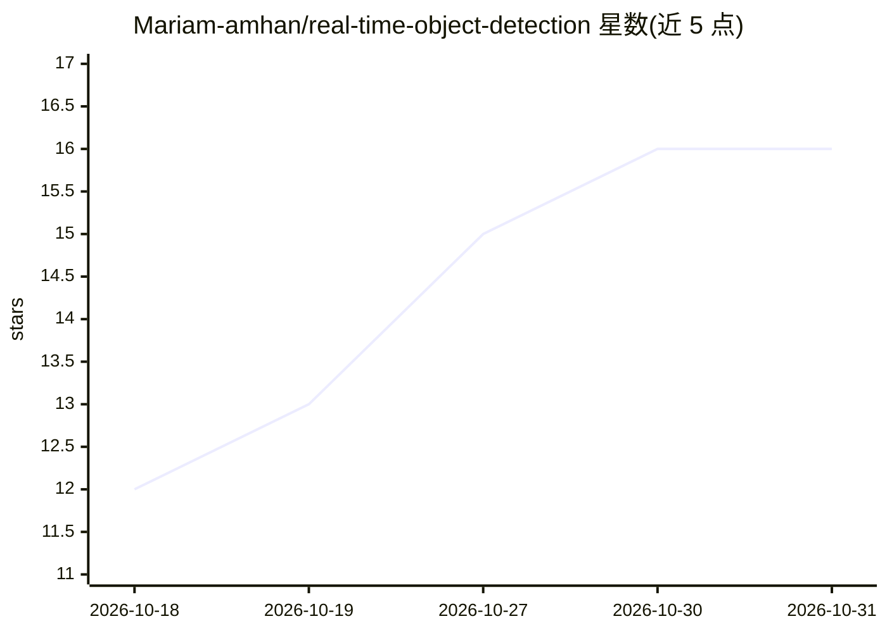

# Mariam-amhan/real-time-object-detection

⭐ 16 · Python · 推送 2026-10-12 · [GitHub](https://github.com/Mariam-amhan/real-time-object-detection) · 个人维护

**YOLOv8+OpenCV 实时检测摄像头画面中的人/车/猫/狗**

基于 Python、Ultralytics YOLOv8n 预训练模型与 OpenCV 的实时目标检测应用：从摄像头或 RTSP 流读取画面，检测 Person、Dog、Cat、Car 四类目标，显示边界框、置信度、分类计数与输入输出 FPS。采用独立采集线程与容量为 2 的有界帧队列丢弃旧帧以缓解延迟，支持 CPU 运行及 Windows/Linux 上检测到 CUDA 设备时自动加速，macOS 走 CPU。端到端延迟尚未实测。

## 筛选速览

| 维度 | 判定 | 备注 |
|---|---|---|
| AI 角色 | `ai-native` | 本体是模型或模型工具 |
| 许可风险 | `none` | — |
| 部署形态 | `library` | 以包/库形式分发 |
| 模型依赖 | — | README 未给出锁定关系 |
| 硬件要求 | — | 无带数字的原话,不猜 |
| 安装摩擦 | `medium` | 含编译或系统依赖之一 |
| 成熟度 | — | 结构信号不足 |

## 能力要点

- YOLOv8n 预训练模型检测四类目标（人/狗/猫/车）
- 多线程采集 + 容量 2 的有界帧队列丢弃旧帧
- CPU 运行与 CUDA 加速自动选择（macOS 仅 CPU）
- 支持摄像头与可配置 RTSP 流输入

## 适用场景

- 从摄像头实时查看并统计画面中的人、车、猫、狗
- 接入 RTSP 摄像头流做实时目标检测
- 学习多线程视频采集与有界队列的帧缓冲处理

## 场景标签

`目标检测` · 领域:感知与多模态

## 证据(README 行号)

> L5: A real-time object detection application built with Python, YOLOv8, and OpenCV.
> L7: The application uses a pre-trained YOLOv8n model to detect four object classes — **Person, Dog, Cat, and Car** — fro

## 星数曲线

2026-10-18 12 → 2026-10-31 16（+4）

---
*卡片 v1 · prompt 1.4 · 生成 2026-10-30 · 置信度 high · 依据 README sha `ac74f1c1b5c9` · [字段定义](../../DATASET.md)*
