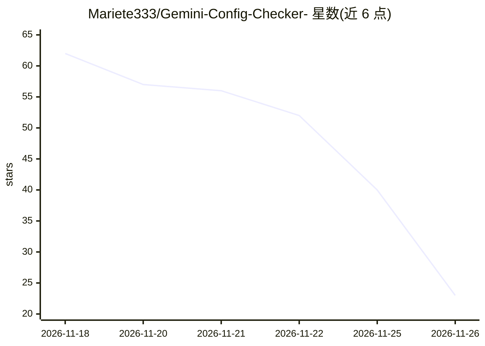

# Mariete333/Gemini-Config-Checker-

⭐ 23 · Go · Apache-2.0 · 推送 2026-11-19 · [GitHub](https://github.com/Mariete333/Gemini-Config-Checker-) · 个人维护

**代理配置扫描器：逐条检验能否进入 Google AI Studio 与 Gemini**

以桌面应用（Windows/macOS/Linux/Android APK）与 Web 服务器两种形态运行，支持 Simple/Advanced 两种扫描模式：Simple 检测用户已有配置，Advanced 将免费配置链接到可用的基础配置之后。核心机制是以登录状态浏览器读取 Google 页面的区域判定（AI Studio 重定向或 Gemini 国家提示），配合连通性预筛与可编辑的反 DPI profile（Finalmask/指纹/ALPN/密码套件），结果可导出链接、base64 或 Xray 配置。版本 0.1.0 为早期预发布，仅 Windows 经实机运行验证。

## 筛选速览

| 维度 | 判定 | 备注 |
|---|---|---|
| AI 角色 | `ai-ecosystem` | LLM/agent 周边工具 |
| 许可风险 | `permissive` | Apache-2.0 |
| 部署形态 | `desktop` | 安装包/桌面程序 |
| 模型依赖 | — | README 未给出锁定关系 |
| 硬件要求 | — | 无带数字的原话,不猜 |
| 安装摩擦 | `medium` | 含编译或系统依赖之一 |
| 成熟度 | `idea` | |

## 能力要点

- 登录态浏览器区域检测，而非纯 HTTP 连通性探测
- Simple/Advanced 双模式，支持订阅 URL、base64 与 vless/vmess/trojan/ss 链接
- 可编辑的反 DPI profile 与本地分片转发器
- 导出单配置或 base→free 链式 Xray 配置

## 适用场景

- 依赖代理配置访问 Google AI Studio/Gemini，想先验证哪些配置可用
- Cloudflare 配置连通但出口被 Google 拦截，需要链出其他出口
- 在过滤网络中测试配置前先批量筛选

## 场景标签

 · 领域:网络工具/代理检测

## 证据(README 行号)

> L11: Find proxy configs that actually get you into **Google AI Studio and Gemini**, by testing each one the way a person
> L64: |Platform|Desktop app (native window)|Web server (UI in your browser)|Region check|

## 星数曲线

2026-11-18 62 → 2026-11-26 23（-39）

---
*卡片 v1 · prompt 1.4 · 生成 2026-11-20 · 置信度 high · 依据 README sha `3d814c5f35f7` · [字段定义](../../DATASET.md)*
