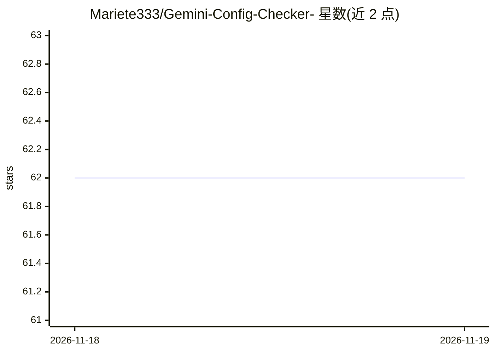

# Mariete333/Gemini-Config-Checker-

⭐ 62 · Go · Apache-2.0 · 推送 2026-11-18 · [GitHub](https://github.com/Mariete333/Gemini-Config-Checker-) · 个人维护

**用已登录浏览器实测代理配置能否进入 AI Studio 与 Gemini**

桌面/Web/Android 应用：对用户提供的代理配置（vless/vmess/trojan/ss 链接、订阅 URL 或 base64）逐一发起登录态浏览器检测，读取 Google 对 AI Studio 与 Gemini 的地区判定，输出健康/被墙/错误与延迟；Simple 模式测试自有配置，Advanced 模式把免费配置串接到可用 base config 之后寻找其他出口。内置 anti-DPI 分片转发器，测试结果标注为抽样而非保证。发布 Windows/macOS/Linux 安装包与 Web server 版，区域检测需 Chrome/Edge/Brave。

## 筛选速览

| 维度 | 判定 | 备注 |
|---|---|---|
| AI 角色 | `ai-ecosystem` | LLM/agent 周边工具 |
| 许可风险 | `permissive` | Apache-2.0 |
| 部署形态 | `desktop` | 安装包/桌面程序 |
| 模型依赖 | — | README 未给出锁定关系 |
| 硬件要求 | — | 无带数字的原话,不猜 |
| 安装摩擦 | `medium` | 含编译或系统依赖之一 |
| 成熟度 | `idea` | |

## 能力要点

- 以已登录浏览器读取 Google 地区判定，而非仅连通性探测
- Advanced 模式将免费配置链式接到 base config 之后导出 chain Xray 配置
- 可编辑的 anti-DPI 分片（Finalmask/fingerprint/ALPN/cipher）配置，内置本地分片转发器
- 导出链接、base64 或完整 Xray 配置，附 SHA256 校验文件

## 适用场景

- 检测手头的代理配置是否能正常打开 Google AI Studio 和 Gemini
- 在过滤网络里测试配置前先验证可用性
- Cloudflare 出口被地区墙挡住时，扫描免费配置链式换出口

## 场景标签

 · 领域:网络工具/代理配置检测

## 证据(README 行号)

> L11: Find proxy configs that actually get you into **Google AI Studio and Gemini**, by testing each one the way a person
> L113: The region check opens AI Studio and Gemini as *you*. Click **Sign in with Google** once:

## 星数曲线

2026-11-18 62 → 2026-11-19 62（+0）

---
*卡片 v1 · prompt 1.4 · 生成 2026-11-19 · 置信度 mid · 依据 README sha `7d4e3e000e83` · [字段定义](../../DATASET.md)*
