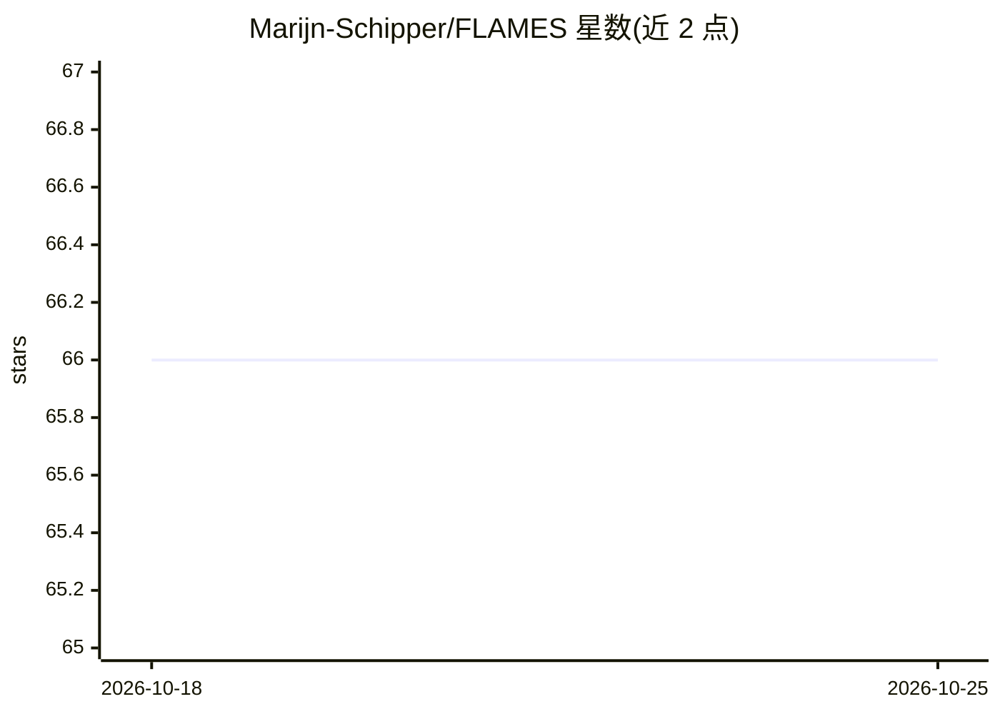

# Marijn-Schipper/FLAMES

⭐ 66 · Python · MIT · 推送 2026-08-25 · [GitHub](https://github.com/Marijn-Schipper/FLAMES) · [官网](https://www.nature.com/articles/s41588-025-02084-7) · 个人维护

**GWAS 位点基因优先化工具：为可信集位点预测致病基因**

面向遗传学研究的命令行工具：在 GWAS 可信集（credible sets）上整合 MAGMA 基因级 Z 分数、PoPS 特征分数及 VEP/CADD 注释，用 XGBoost 模型（FLAMES 分数）对每个位点的候选基因排序，输出预测基因、缩放分数与校准的累计精确度估计。流程需先用 MAGMA 生成基因 Z 分数与组织相关性分析、运行 PoPS 生成特征，再经 FLAMES annotate 与 FLAMES 打分两步完成。默认使用 hg19 基因组构建（可 -b GRCh38，内部用 pyliftover 转换），注释数据与 GTEx/PoPS 特征需从 Zenodo 下载。

## 筛选速览

| 维度 | 判定 | 备注 |
|---|---|---|
| AI 角色 | `ai-native` | 本体是模型或模型工具 |
| 许可风险 | `permissive` | MIT |
| 部署形态 | `library` | 以包/库形式分发 |
| 模型依赖 | — | README 未给出锁定关系 |
| 硬件要求 | — | 无带数字的原话,不猜 |
| 安装摩擦 | `low` | 无编译、无系统依赖或容器化 |
| 成熟度 | `idea` | |

## 能力要点

- 整合 MAGMA Z 分数、PoPS 分数与 VEP/CADD 注释的基因优先化打分
- 输出累计精确度估计，默认仅保留 75% 精度阈值以上基因
- 支持 hg19 与 GRCh38（内部 pyliftover 转换）
- 可用本地命令行 VEP 与 tabixed CADD 加速注释

## 适用场景

- 对 GWAS 可信集位点的候选基因排序，找出最可能的致病基因
- 复现 FLAMES 论文中双胎（twinning）位点的分析结果
- 在自有汇总统计数据上完成从 MAGMA 到基因打分的全流程

## 场景标签

 · 领域:遗传学/生物信息学

## 证据(README 行号)

> L4: Thank you for your interest in using FLAMES for GWAS gene prioritization.
> L133: - FLAMES_scores.preds is a tab-delimited file containing the scored annotation filename, the predicted gene, the r

## 星数曲线

2026-10-18 66 → 2026-10-25 66（+0）

---
*卡片 v1 · prompt 1.4 · 生成 2026-10-24 · 置信度 mid · 依据 README sha `e6753ed183a4` · [字段定义](../../DATASET.md)*
