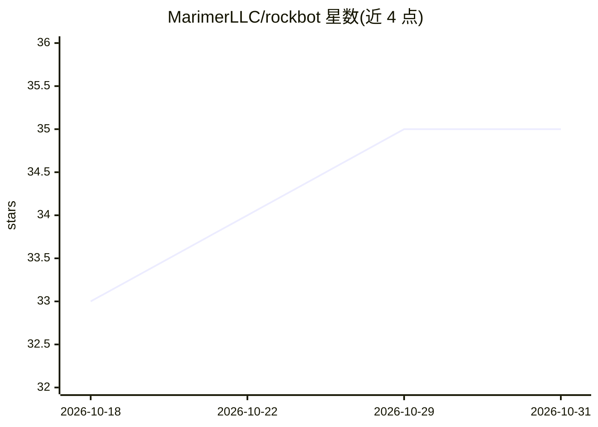

# MarimerLLC/rockbot

⭐ 35 · C# · MIT · 推送 2026-10-30 · [GitHub](https://github.com/MarimerLLC/rockbot) · 个人维护

**事件驱动的多 agent AI 框架：agent 经消息总线通信与隔离执行**

基于 .NET 的多 agent AI 系统构建框架。agent 作为独立进程仅通过 RabbitMQ 主题总线（本地开发可用进程内总线）通信，无共享内存、无进程内 LLM 生成代码执行；LLM 调用经 Microsoft.Extensions.AI 三层路由，工具经 MCP 桥、Web 工具、调度器提供，脚本在临时 Kubernetes Pod 中隔离执行。含三级记忆（会话/长期/工作）、技能学习与 BM25 召回、子 agent 生成、A2A 网关与 Blazor/Cli 聊天界面。设计目标为最小权限与云原生（无状态组件、独立伸缩、OpenTelemetry 观测）。

## 筛选速览

| 维度 | 判定 | 备注 |
|---|---|---|
| AI 角色 | `ai-ecosystem` | LLM/agent 周边工具 |
| 许可风险 | `permissive` | MIT |
| 部署形态 | `self-host` | docker 或自建部署 |
| 模型依赖 | — | README 未给出锁定关系 |
| 硬件要求 | — | 无带数字的原话,不猜 |
| 安装摩擦 | `low` | 无编译、无系统依赖或容器化 |
| 成熟度 | — | 结构信号不足 |

## 能力要点

- agent 独立进程 + RabbitMQ 主题总线通信，LLM 生成代码不在宿主进程内运行
- LLM 集成经 Microsoft.Extensions.AI 三层路由与逐模型行为覆盖
- 三级记忆与经验学习的技能系统（BM25 召回、后台 dream 整合优化）
- 脚本在无网络临时 Kubernetes Pod 中隔离执行，A2A/MCP 服务统一搜索

## 适用场景

- 构建需要隔离与最小权限的多 agent 系统
- 通过 A2A 网关让外部客户端调用 agent 任务
- 在云原生环境中独立伸缩 LLM worker 与脚本执行器

## 场景标签

`多智能体` · 领域:Agent 开发

## 证据(README 行号)

> L9: RockBot is a framework for building **multi-agent AI systems** where agents communicate exclusively through a messag
> L13: Each agent is an isolated process that reacts to messages, invokes tools, calls LLMs, delegates work to other agent
> L29: |`RockBot.Llm`|LLM integration via `Microsoft.Extensions.AI` — three-tier routing, per-model behavior overrides, ke

## 星数曲线

2026-10-18 33 → 2026-10-31 35（+2）

---
*卡片 v1 · prompt 1.4 · 生成 2026-10-25 · 置信度 high · 依据 README sha `ba07a42cd6cf` · [字段定义](../../DATASET.md)*
