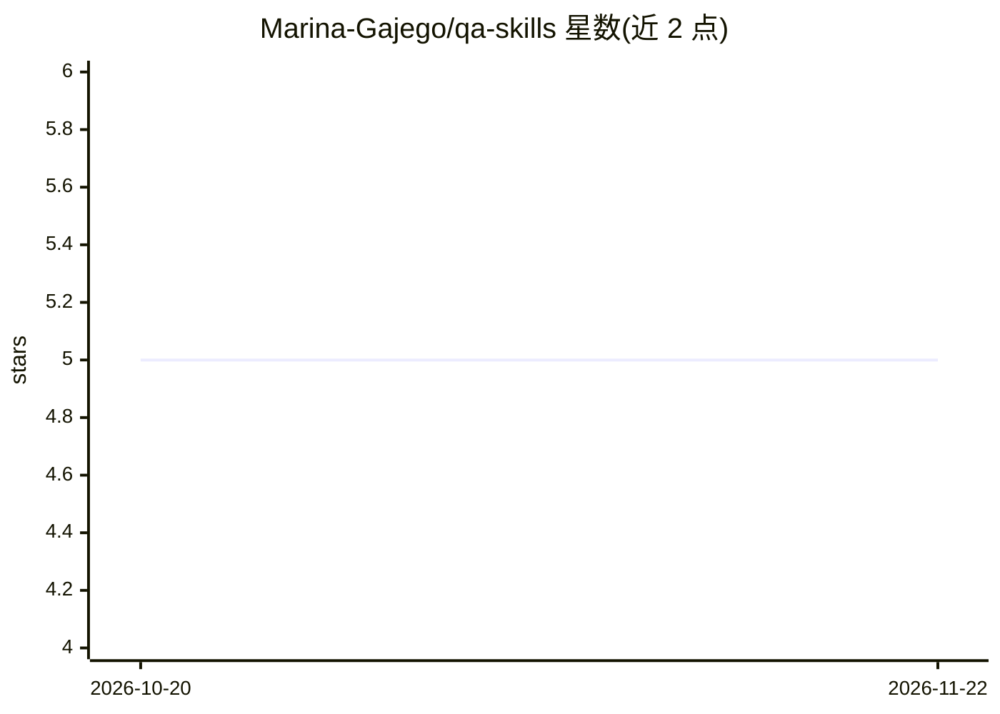

# Marina-Gajego/qa-skills

⭐ 5 · Python · MIT · 推送 2026-10-28 · [GitHub](https://github.com/Marina-Gajego/qa-skills) · 个人维护

**教 AI 代理执行 QA 工作的可复用技能集**

由 QA 工程师维护的开源技能合集：不是代码库，而是以 Agent Skills 格式（SKILL.md）打包的 QA 实践指令，供 Claude、Copilot、Codex、Gemini 等代理按描述自动加载。现有 4 个技能：测试栈勘察（写入 .qa-skills/ 供后续技能复用团队风格）、按团队风格写自动化测试、SBTM 探索性测试（默认走 Playwright MCP）、把证据转成 Jira 风格缺陷报告。技能相互独立，也可通过共享文件夹传递上下文；结果需人工审核。状态为早期阶段，仅部分栈经验证。

## 筛选速览

| 维度 | 判定 | 备注 |
|---|---|---|
| AI 角色 | `ai-knowledge` | 知识聚合/清单类 |
| 许可风险 | `permissive` | MIT |
| 部署形态 | `None` |  |
| 模型依赖 | — | README 未给出锁定关系 |
| 硬件要求 | — | 无带数字的原话,不猜 |
| 安装摩擦 | `low` | 无编译、无系统依赖或容器化 |
| 成熟度 | `idea` | |

## 能力要点

- 4 个独立技能覆盖勘察、自动化、探索性测试与缺陷报告
- 技能间通过 .qa-skills/ 文件夹传递上下文
- 采用开放 Agent Skills 格式，可跨 AI 工具复用
- 支持英语/葡萄牙语/西班牙语输出配置

## 适用场景

- 让 AI 代理按团队既有写法补充自动化测试
- 对 Web/API 应用运行 SBTM 探索性测试并产出会话报告
- 把日志、失败测试等证据整理成可复现的缺陷工单

## 场景标签

`提示工程` `浏览器自动化` `代码审查` · 领域:Agent 开发

## 证据(README 行号)

> L3: > An open collection of QA **skills** — reusable instructions that help AI agents (Claude, Copilot, Codex, Gemini an
> L5: Instead of a library of code, this repository is made of **know-how**: each skill packages a QA practice so an AI ag
> L7: **Status:** 🚧 Early stage — four skills available today, more being added over time.

## 星数曲线

2026-10-20 5 → 2026-11-22 5（+0）

---
*卡片 v1 · prompt 1.4 · 生成 2026-11-21 · 置信度 high · 依据 README sha `4f43fd200b9a` · [字段定义](../../DATASET.md)*
