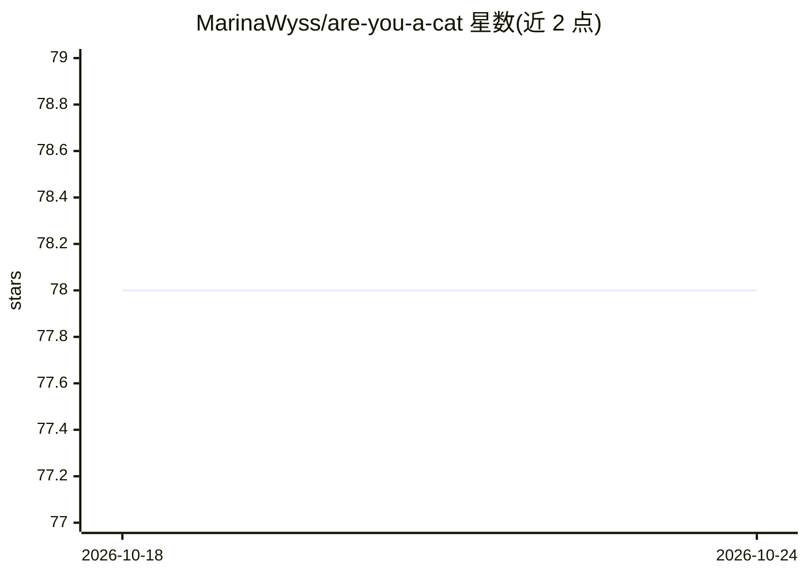

# MarinaWyss/are-you-a-cat

⭐ 78 · HTML · 推送 2026-07-09 · [GitHub](https://github.com/MarinaWyss/are-you-a-cat) · 个人维护

**判断自拍是否为猫的端到端 MLOps 练习项目**

参加 ZenML Month of MLOps 竞赛的个人练习项目：用 ZenML 编排训练、评估与持续部署管道，基于 TensorFlow Keras 的 2D CNN 对猫/狗/自拍/杂图四类数据训练二分类模型（留出集 recall 0.8、precision 0.53），经 MLflow 记录实验与本地部署，Streamlit 应用接收照片返回‘是猫’的概率并将用户反馈存入 S3。作者自述为第一版尝试，存在数据校验未集成管道、仅本地小数据训练、无模型验证与监控等限制。README 未给出安装命令。

## 筛选速览

| 维度 | 判定 | 备注 |
|---|---|---|
| AI 角色 | `ai-native` | 本体是模型或模型工具 |
| 许可风险 | `none` | — |
| 部署形态 | `None` |  |
| 模型依赖 | — | README 未给出锁定关系 |
| 硬件要求 | — | 无带数字的原话,不猜 |
| 安装摩擦 | `low` | 无编译、无系统依赖或容器化 |
| 成熟度 | `idea` | |

## 能力要点

- ZenML 端到端管道：数据清洗→训练→评估→达标触发 MLflow 本地再部署
- 2D CNN 分类器，MLflow autologging 记录模型、超参与指标
- Streamlit 推理应用：上传照片返回是猫概率，反馈存 S3 供漂移检测
- Deep Checks 数据校验脚本（未集成管道，单独运行）

## 适用场景

- 参考一个小型端到端 MLOps 管道的实现方式
- 了解 ZenML+MLflow+Streamlit 的持续部署工作流
- 学习将模型评估阈值作为部署触发条件的做法

## 场景标签

`MLOps` `目标检测` · 领域:感知与多模态

## 证据(README 行号)

> L17: This project uses ZenML to build a simple end-to-end pipeline for a model to identify if a photo (selfie) uploaded 
> L40: The model for this project is a 2D CNN, implemented with Tensorflow Keras. The model, hyperparameters, and training

## 星数曲线

2026-10-18 78 → 2026-10-24 78（+0）

---
*卡片 v1 · prompt 1.4 · 生成 2026-10-24 · 置信度 high · 依据 README sha `f671fe7829a6` · [字段定义](../../DATASET.md)*
