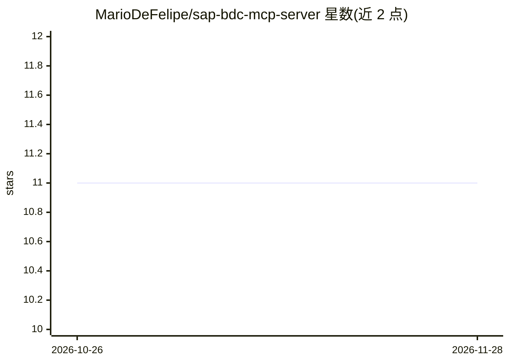

# MarioDeFelipe/sap-bdc-mcp-server

⭐ 11 · Python · MIT · 推送 2026-05-02 · [GitHub](https://github.com/MarioDeFelipe/sap-bdc-mcp-server) · [官网](https://pypi.org/project/sap-bdc-mcp-server/) · 个人维护

**让 AI 助手经 MCP 操作 SAP BDC 数据共享的服务器**

基于 Model Context Protocol 的服务器，封装 SAP BDC Connect SDK，向 Claude Desktop 等 AI 客户端暴露 7 个工具：创建/更新数据共享（ORD 与 CSN 元数据）、发布与下架数据产品、删除共享、从 Databricks 共享生成 CSN 模板、端到端一键配置（建共享、授权、注册）以及注册前预检校验。提供 LocalDatabricksClient 绕过 SDK 原有的 dbutils 依赖，支持本地运行与 CI/CD。要求 Python 3.9+、Databricks 环境与 SAP BDC 账户。

## 筛选速览

| 维度 | 判定 | 备注 |
|---|---|---|
| AI 角色 | `ai-ecosystem` | LLM/agent 周边工具 |
| 许可风险 | `permissive` | MIT |
| 部署形态 | `library` | 以包/库形式分发 |
| 模型依赖 | locked-api |  |
| 硬件要求 | — | 无带数字的原话,不猜 |
| 安装摩擦 | `low` | 无编译、无系统依赖或容器化 |
| 成熟度 | — | 结构信号不足 |

## 能力要点

- 7 个 MCP 工具覆盖 Delta Sharing 共享管理与数据产品发布
- provision_share 一步完成建共享、授权表与 BDC 注册
- validate_share_readiness 注册前预检，输出可操作的下一步指引
- LocalDatabricksClient 使 SDK 无需 dbutils 即可本地运行

## 适用场景

- 在 Claude Desktop 中用自然语言管理 SAP BDC 数据共享
- CI/CD 流水线中自动校验共享就绪状态后再注册
- 为已有 Databricks 共享自动生成 CSN 模板

## 场景标签

 · 领域:数据基础设施/企业数据集成

## 证据(README 行号)

> L7: An MCP (Model Context Protocol) server that provides integration with SAP Business Data Cloud (BDC) Connect SDK. Thi
> L323: - **MCP SDK**: For protocol implementation

## 星数曲线

2026-10-26 11 → 2026-11-28 11（+0）

---
*卡片 v1 · prompt 1.4 · 生成 2026-11-19 · 置信度 high · 依据 README sha `35629cfe21c4` · [字段定义](../../DATASET.md)*
