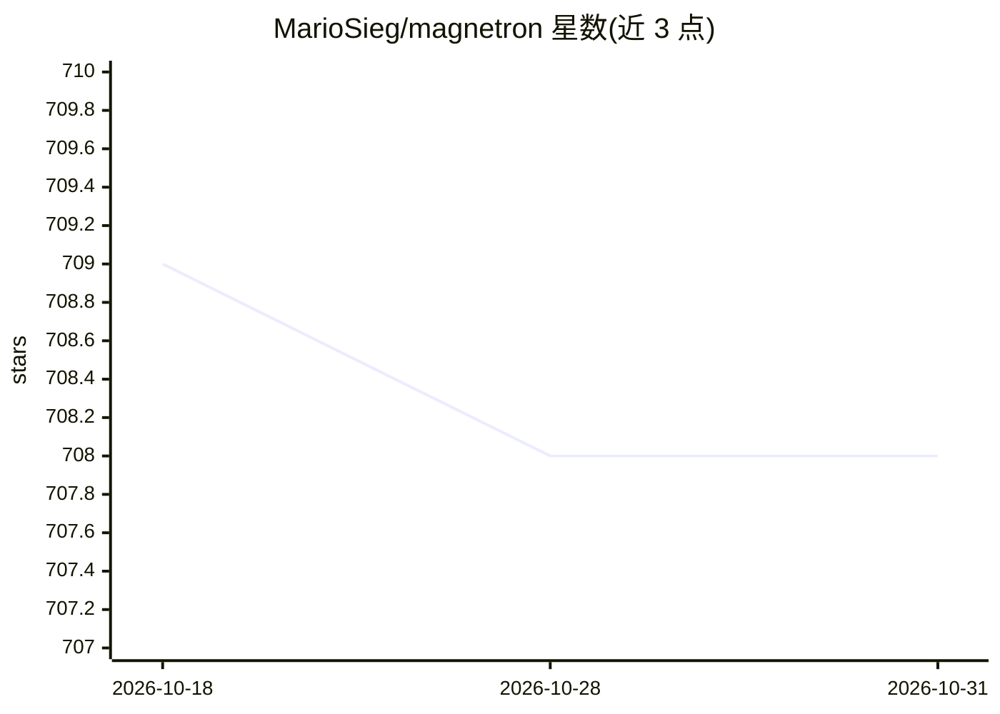

# MarioSieg/magnetron

⭐ 708 · C · NOASSERTION · 推送 2026-10-30 · [GitHub](https://github.com/MarioSieg/magnetron) · 个人维护

**零依赖 C 实现的紧凑 ML 运行时，附带 Python API**

用 C 从零构建的机器学习运行时，自带张量系统、算子集、反向模式自动微分引擎与执行模型，不依赖大型外部框架，通过原生扩展提供 Python 接口，无必需 Python 依赖。CPU 后端按 Intel/AMD/ARM 微架构提供编译期优化内核，运行时经 CPUID 自动选择路径，支持多种 SIMD 指令集与多线程；CUDA 后端开发中。提供零拷贝内存映射的 .mag 模型格式及外部权重转换工具，示例含 Qwen3 BF16 推理、GPT-2 推理与自编码器训练。适用场景为需要完全控制执行与内存、或作为实验与系统研究基础的开发者。自身定位为不与 PyTorch 在生态与功能数量上竞争。

## 筛选速览

| 维度 | 判定 | 备注 |
|---|---|---|
| AI 角色 | `ai-ecosystem` | LLM/agent 周边工具 |
| 许可风险 | `none` | NOASSERTION |
| 部署形态 | `library` | 以包/库形式分发 |
| 模型依赖 | — | README 未给出锁定关系 |
| 硬件要求 | — | 无带数字的原话,不猜 |
| 安装摩擦 | `medium` | 含编译或系统依赖之一 |
| 成熟度 | — | 结构信号不足 |

## 能力要点

- 自研张量系统、算子集与反向模式 autograd，无运行时依赖
- CPU 后端针对 Intel/AMD Zen1–Zen5/ARM 提供编译期优化内核，CPUID 运行时自动选择，支持 SSE 到 AVX-512、ARM NEON 等指令集与多线程
- 零拷贝内存映射 .mag 模型格式与外部权重转换工具
- 示例覆盖 Qwen3 BF16 推理、GPT-2 推理、自编码器训练

## 适用场景

- 理解并控制模型执行的内存布局、内核分发与图行为
- 修改算子、添加内核或实验新的执行策略
- 将 ML 负载移植到特殊硬件平台

## 场景标签

`推理引擎` · 领域:训练与推理

## 证据(README 行号)

> L26: **Magnetron** is a machine learning runtime built from scratch in C, with a small modern Python interface for usabi
> L27: It implements its own tensor system, operator set, autograd engine, and execution model - without relying on large 
> L34: - when you want **full control over execution and memory**

## 星数曲线

2026-10-18 709 → 2026-10-31 708（-1）

---
*卡片 v1 · prompt 1.4 · 生成 2026-10-21 · 置信度 high · 依据 README sha `143271684aa9` · [字段定义](../../DATASET.md)*
