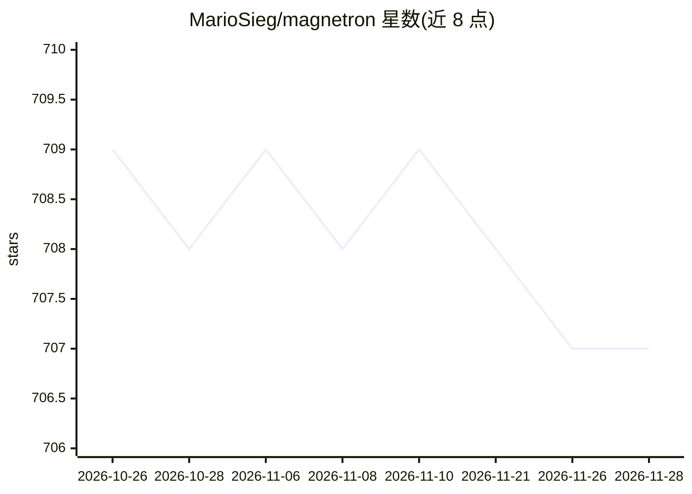

# MarioSieg/magnetron

⭐ 707 · C · NOASSERTION · 推送 2026-11-24 · [GitHub](https://github.com/MarioSieg/magnetron) · 个人维护

**给想掌控全栈的开发者：C 实现的零依赖 ML 运行时与 Python API**

用 C 从零实现的机器学习运行时，自带张量系统、算子集、autograd 引擎与执行模型，提供 Python 接口。CPU 后端按微架构编译优化内核，运行时经 CPUID 检测选择路径，支持 SSE/AVX-512/NEON 等 SIMD ISA 与多线程；CUDA 后端在开发中。序列化采用零拷贝内存映射的 .mag 格式，提供权重导入转换工具。示例覆盖 Qwen3/GPT-2 推理、自编码器训练等。PyPI 安装，无 Python 依赖。

## 筛选速览

| 维度 | 判定 | 备注 |
|---|---|---|
| AI 角色 | `ai-native` | 本体是模型或模型工具 |
| 许可风险 | `none` | NOASSERTION |
| 部署形态 | `library` | 以包/库形式分发 |
| 模型依赖 | — | README 未给出锁定关系 |
| 硬件要求 | — | 无带数字的原话,不猜 |
| 安装摩擦 | `medium` | 含编译或系统依赖之一 |
| 成熟度 | `idea` | |

## 能力要点

- 自研张量系统、算子集、动态 autograd 图与统一执行模型
- CPU 后端按 Intel/AMD Zen/ARM 微架构优化，CPUID 自动选核
- 零拷贝内存映射的 .mag 模型格式与权重转换工具
- 示例含 Qwen3 BF16 推理（带 CLI 聊天与 HTTP/流式 API）

## 适用场景

- 理解并实验内核、内存布局与执行策略
- 把 ML 工作负载移植到非常规硬件
- 在自己的代码中嵌入一个无 Python 依赖的推理运行时

## 场景标签

`推理引擎` · 领域:训练与推理

## 证据(README 行号)

> L26: **Magnetron** is a machine learning runtime built from scratch in C, with a small modern Python interface for usabi
> L27: It implements its own tensor system, operator set, autograd engine, and execution model - without relying on large 

## 星数曲线

2026-10-26 709 → 2026-11-28 707（-2）

---
*卡片 v1 · prompt 1.4 · 生成 2026-11-24 · 置信度 high · 依据 README sha `68b5537c9b8a` · [字段定义](../../DATASET.md)*
