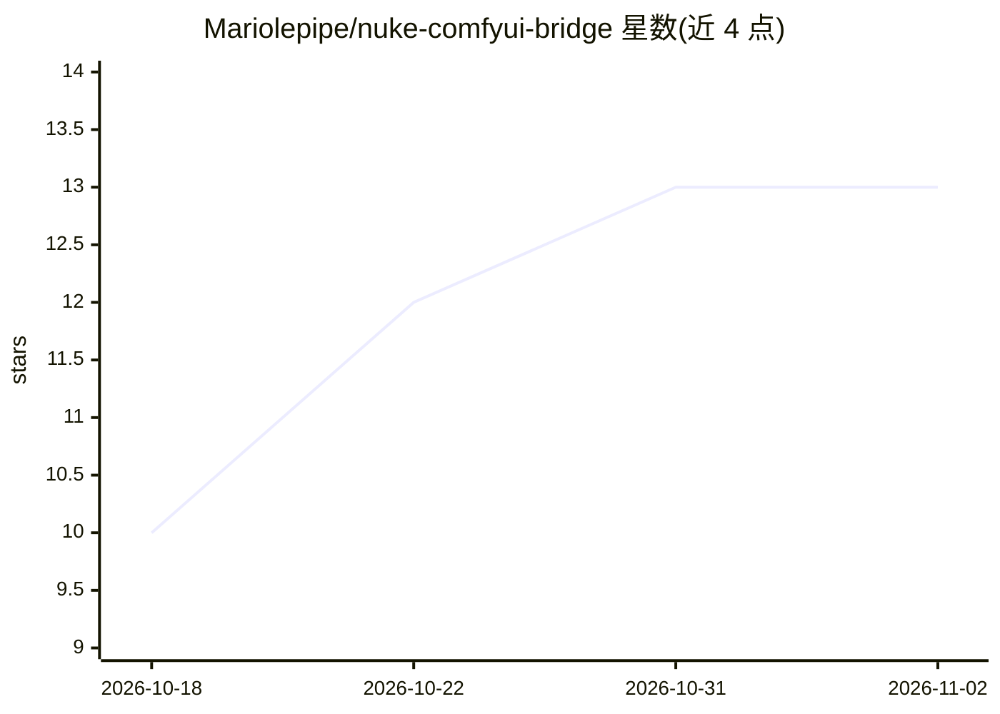

# Mariolepipe/nuke-comfyui-bridge

⭐ 13 · Python · MIT · 推送 2026-10-08 · [GitHub](https://github.com/Mariolepipe/nuke-comfyui-bridge) · [官网](mariofalco.fr) · 个人维护

**从 Nuke 面板调用 ComfyUI 为镜头生成法线/深度/位置/抠像 AOV**

面向 VFX 合成人员的 Nuke 与 ComfyUI 桥接工具：在 Nuke 面板中选择工作流后，将帧序列送至本机 ComfyUI，运行 Sapiens2、MoGe、Video Depth Anything、RAFT 与 LTX-2.5 Alpha Gen 等模型，生成相机空间法线（含时域稳定）、米制深度、位置层与软边 alpha 抠像，按帧写回多层 EXR 并作为 Read 节点载入。支持添加自定义 API 格式工作流并在面板中配置参数。限制：深度与相机为估计值，抠像最大 1920 宽，需 24 GB 级显卡与大内存，ComfyUI 须与 Nuke 同机运行。

## 筛选速览

| 维度 | 判定 | 备注 |
|---|---|---|
| AI 角色 | `ai-ecosystem` | LLM/agent 周边工具 |
| 许可风险 | `permissive` | MIT |
| 部署形态 | `None` |  |
| 模型依赖 | — | README 未给出锁定关系 |
| 硬件要求 | — | 无带数字的原话,不猜 |
| 安装摩擦 | `low` | 无编译、无系统依赖或容器化 |
| 成熟度 | `idea` | |

## 能力要点

- 在 Nuke 面板内生成法线/深度/位置/alpha 多层 EXR
- 法线时域稳定：RAFT 光流 warp 加平均并带遮挡/快速运动剔除
- Sapiens2 人物分割 + MoGe 背景的法线混合策略
- 可添加任意 ComfyUI API 工作流并在面板中自定义参数

## 适用场景

- 在合成流程中为镜头快速生成 relighting/defocus 用的几何 AOV
- 用 LTX-2.5 Alpha Gen 生成带软边和发丝的 alpha 抠像
- 把自己的 ComfyUI 工作流接入 Nuke 面板批量跑帧

## 场景标签

`图像视频处理` · 领域:感知与多模态

## 证据(README 行号)

> L3: Generates normals, depth, position and an alpha matte for a plate in ComfyUI, from a panel in Nuke. One multi-layer 
> L39: Copy `comfyui/ComfyUI-NukeBridge` into `ComfyUI/custom_nodes/`, then install these node packs (ComfyUI Manager find
> L74: ComfyUI has to run on the same machine as Nuke: the frames are passed to it as a folder on disk.

## 星数曲线

2026-10-18 10 → 2026-11-02 13（+3）

---
*卡片 v1 · prompt 1.4 · 生成 2026-10-31 · 置信度 high · 依据 README sha `2c8d3d7b47d9` · [字段定义](../../DATASET.md)*
