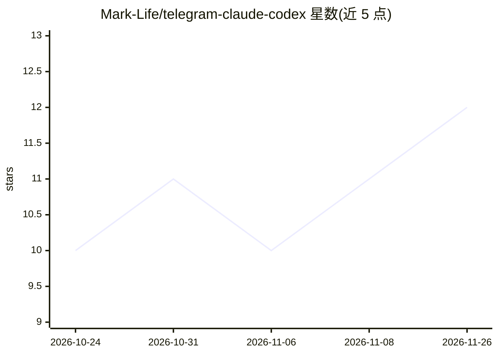

# Mark-Life/telegram-claude-codex

⭐ 12 · TypeScript · MIT · 推送 2026-11-25 · [GitHub](https://github.com/Mark-Life/telegram-claude-codex) · [官网](https://andrey-markin.com/projects/telegram-claude) · 个人维护

**在 VPS 上通过 Telegram bot 运行 Claude Code/Codex 的接入层**

基于 Bun 与 grammY 的 Telegram 机器人，在用户 VPS 的项目目录中运行 Claude Code 或 OpenAI Codex 编码代理，并将回答流式回传聊天。以 Telegram 论坛话题为独立会话，支持运行时用 /provider 切换提供方、项目目录切换、消息队列、语音消息经 Groq Whisper 转写、plan 模式审批、SQLite 状态存储与结构化事件日志。依赖宿主机已有的 Claude 订阅登录（SDK 随依赖捆绑）及可选的 Codex CLI 登录，面向需要远程操作编码代理的开发者。

## 筛选速览

| 维度 | 判定 | 备注 |
|---|---|---|
| AI 角色 | `ai-ecosystem` | LLM/agent 周边工具 |
| 许可风险 | `permissive` | MIT |
| 部署形态 | `None` |  |
| 模型依赖 | locked-api |  |
| 硬件要求 | — | 无带数字的原话,不猜 |
| 安装摩擦 | `low` | 无编译、无系统依赖或容器化 |
| 成熟度 | — | 结构信号不足 |

## 能力要点

- 每个论坛话题为独立会话，支持并行运行与消息排队
- 运行时 /provider 在 Claude Code 与 OpenAI Codex 间切换
- 语音消息经 Groq Whisper 转写后发给代理
- Claude Agent SDK 默认加载锁定的安全 Settings，可用 CLAUDE_SETTINGS_JSON 覆盖

## 适用场景

- 在手机 Telegram 上远程操作 VPS 项目里的编码代理
- 多个项目会话并行管理
- 通过语音消息向编码代理下达指令

## 场景标签

`编码 Agent` `聊天机器人` `语音识别` · 领域:编码与开发

## 证据(README 行号)

> L5: Telegram bot interface for coding agents (Claude Code + OpenAI Codex) on a VPS. Message the bot from any device, it 
> L15: - **Multi-provider** — switch between Claude Code and OpenAI Codex at runtime via `/provider`; sessions and capabil

## 星数曲线

2026-10-24 10 → 2026-11-26 12（+2）

---
*卡片 v1 · prompt 1.4 · 生成 2026-11-19 · 置信度 high · 依据 README sha `62e9fbdfa113` · [字段定义](../../DATASET.md)*
