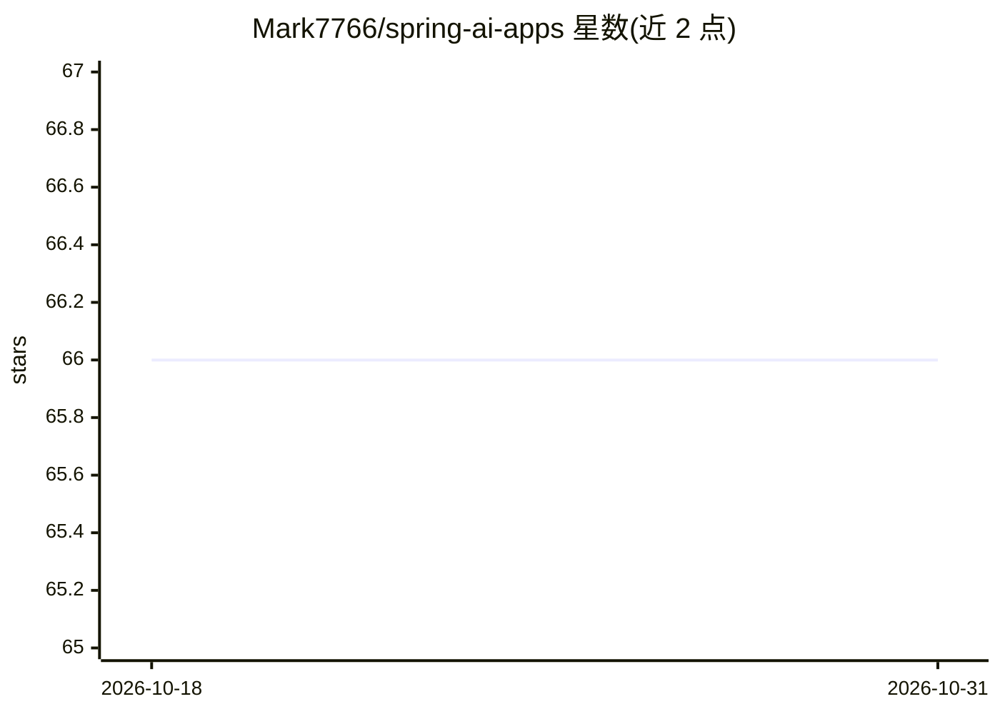

# Mark7766/spring-ai-apps

⭐ 66 · Java · MIT · 推送 2025-12-19 · [GitHub](https://github.com/Mark7766/spring-ai-apps) · 个人维护 · 中文 README

**Spring AI 示例应用合集：覆盖对话、RAG、TextToSQL、MCP 等场景**

一组基于 Spring AI 框架的小型应用集合，目的是帮助开发者学习如何用 Spring AI 开发 AI 应用。每个应用代码精简但框架完整，并处理了版本冲突问题。内容按类别组织：对接 DeepSeek/Azure 的聊天应用、基于 Ollama+Qwen2.5 的私有数据向量问答、Chroma/Neo4j 向量与图存储、自然语言转 SQL 并生成 ECharts 可视化、Tool Calling、MCP Server/Client DEMO，以及使用 ETL Pipeline 的文件问答 RAG 示例。README 未给出安装运行命令。

## 筛选速览

| 维度 | 判定 | 备注 |
|---|---|---|
| AI 角色 | `ai-knowledge` | 知识聚合/清单类 |
| 许可风险 | `permissive` | MIT |
| 部署形态 | `None` |  |
| 模型依赖 | local-ok | 支持本地模型 |
| 硬件要求 | — | 无带数字的原话,不猜 |
| 安装摩擦 | `low` | 无编译、无系统依赖或容器化 |
| 成熟度 | — | 结构信号不足 |

## 能力要点

- 按 Chat Model/Embedding/向量库/MCP/RAG 等类别组织的示例应用列表
- Ollama+Qwen2.5 私有数据向量问答与 GraphRAG（Neo4j）示例
- 自然语言转 SQL 并生成 ECharts 可视化的示例
- MCP Server 与 Client 的配对 DEMO 实现

## 适用场景

- 学习 Spring AI 各能力模块的用法
- 参考搭建私有数据问答或 RAG 应用
- 了解 MCP 服务端与客户端的实现方式

## 场景标签

`RAG` `数据分析` `教程课程` · 领域:效率与自动化

## 证据(README 行号)

> L3: This is a collection of Spring AI small applications, aimed at helping everyone easily learn how to apply Spring AI 
> L4: # Spring AI Small Application List:

## 星数曲线

2026-10-18 66 → 2026-10-31 66（+0）

---
*卡片 v1 · prompt 1.4 · 生成 2026-10-24 · 置信度 high · 依据 README sha `21c27d7683f4` · [字段定义](../../DATASET.md)*
