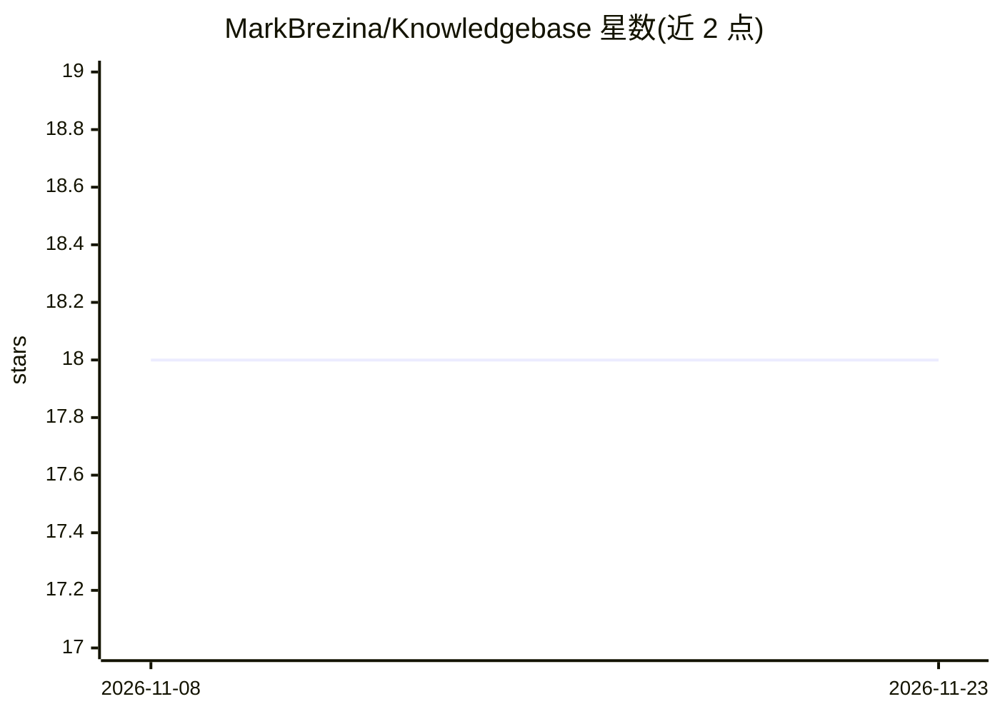

# MarkBrezina/Knowledgebase

⭐ 18 · R · 推送 2026-11-07 · [GitHub](https://github.com/MarkBrezina/Knowledgebase) · 个人维护

**面向量化金融学习者的跨学科资源笔记合集**

以笔记形式组织的资源索引仓库，覆盖量化金融、保险、AI/ML、编程/IT、数学、概率统计等主题；按主题组织书籍、论文、代码链接与 Jupyter notebook 引用，并给出各主题的介绍、组织、论坛、人物、视频、仓库等栏目结构。作者声明后续将逐步改为逐主题的 walkthrough 形式，当前结构仍在变动中。无安装步骤，无运行时组件，仓库本身不提供模型输出。

## 筛选速览

| 维度 | 判定 | 备注 |
|---|---|---|
| AI 角色 | `ai-knowledge` | 知识聚合/清单类 |
| 许可风险 | `none` | — |
| 部署形态 | `None` |  |
| 模型依赖 | — | README 未给出锁定关系 |
| 硬件要求 | — | 无带数字的原话,不猜 |
| 安装摩擦 | `low` | 无编译、无系统依赖或容器化 |
| 成熟度 | `idea` | |

## 能力要点

- 按主题组织的书籍、论文、代码链接与 notebook 索引
- 覆盖量化金融、保险、数学、统计、AI/ML 等多个学科
- 每个主题设介绍、组织、论坛、人物、视频、仓库等固定栏目
- 收录大量 awesome 类清单与外部仓库链接

## 适用场景

- 查找量化金融领域的书籍、论文与代码仓库
- 系统了解保险定价、随机分析等子主题的学习资源
- 收集机器学习在金融领域应用的参考清单

## 场景标签

`精选清单` `金融量化` · 领域:学习与行业

## 证据(README 行号)

> L12: - SUBJECT
> L60: ## Quantitative finance - link
> L72: ## AI and Machine Learning - link
> L115: **resource(Video, website, book, code)**

## 星数曲线

2026-11-08 18 → 2026-11-23 18（+0）

---
*卡片 v1 · prompt 1.4 · 生成 2026-11-18 · 置信度 high · 依据 README sha `a2fa56b3922e` · [字段定义](../../DATASET.md)*
