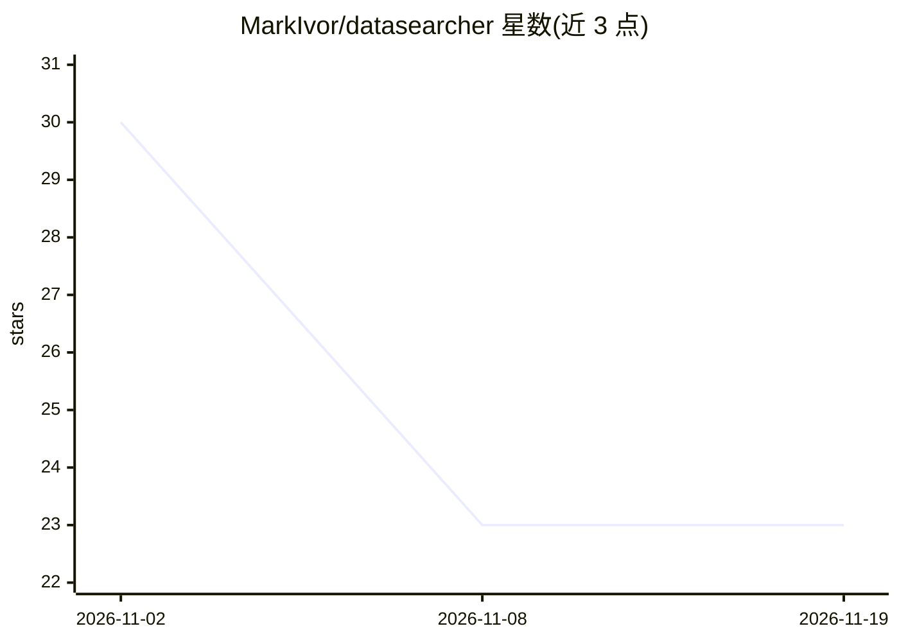

# MarkIvor/datasearcher

⭐ 23 · Python · MIT · 推送 2026-11-01 · [GitHub](https://github.com/MarkIvor/datasearcher) · 个人维护

**对话式数据分析平台：自然语言问数据，产出图表与公开仪表盘**

面向分析师和业务用户的对话式 BI 工具，以 React + FastAPI 提供 Web 界面，同时可作为 MCP 服务器接入 Claude Desktop/Cursor。用户上传表格或连接数据库后，用自然语言提问，由 LLM 调度 46 个分析工具执行 SQL（DuckDB 或下推源库）、生成图表、ML 预测和仪表盘。内置只读守卫、PII 掩码、知识库（SQLite）、sqlglot 方言翻译与审计日志，支持 PostgreSQL/MySQL/ClickHouse/SQLite/REST 连接。需 Python 3.12+、Node.js 20+ 与 LLM API，界面与回答双语（英/俄）。

## 筛选速览

| 维度 | 判定 | 备注 |
|---|---|---|
| AI 角色 | `ai-ecosystem` | LLM/agent 周边工具 |
| 许可风险 | `permissive` | MIT |
| 部署形态 | `self-host` | docker 或自建部署 |
| 模型依赖 | local-ok | 支持本地模型 |
| 硬件要求 | — | 无带数字的原话,不猜 |
| 安装摩擦 | `low` | 无编译、无系统依赖或容器化 |
| 成熟度 | — | 结构信号不足 |

## 能力要点

- 46 个分析工具：SQL、数据画像、ML 预测、聚类、仪表盘生成
- 只读守卫与 PII 自动检测掩码、审计日志、速率限制
- sqlglot 将 DuckDB SQL 翻译为源库方言，支持 4 种连接模式
- 同一核心提供 Web 界面与 MCP 服务器（Claude Desktop/Cursor）两种用法

## 适用场景

- 上传 Excel/CSV 直接用自然语言做数据分析和看趋势
- 连接生产数据库做受控的只读分析并生成公开仪表盘链接
- 在 Claude Desktop 或 Cursor 中通过 MCP 直接调用这些分析工具

## 场景标签

`数据分析` · 领域:效率与自动化

## 证据(README 行号)

> L23: |**Web Interface**|Chat dashboard: React UI + FastAPI, plain-language dialogue, charts, dashboards, admin panel|Ana
> L24: |**MCP**|MCP server (Claude Desktop, Cursor, VS Code): the same 46 tools right in your AI client|Claude/Cursor user
> L57: 3. The LLM picks the right tools, runs SQL (in DuckDB or pushed down to the source DB), builds charts

## 星数曲线

2026-11-02 30 → 2026-11-19 23（-7）

---
*卡片 v1 · prompt 1.4 · 生成 2026-11-18 · 置信度 mid · 依据 README sha `dbaca13f053a` · [字段定义](../../DATASET.md)*
