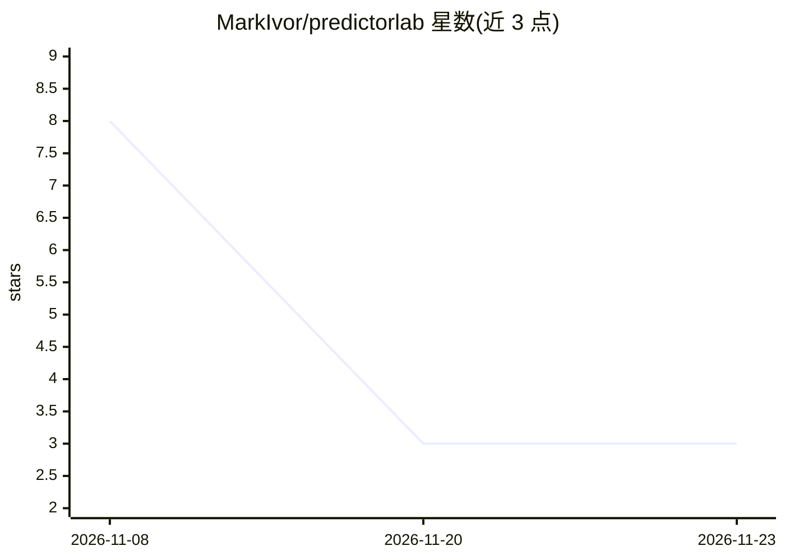

# MarkIvor/predictorlab

⭐ 3 · Python · MIT · 推送 2026-11-04 · [GitHub](https://github.com/MarkIvor/predictorlab) · 个人维护 · 中文 README

**给无 DS 团队的分析师用的自托管表格 ML 平台**

自托管的表格机器学习平台：上传 CSV/XLSX/Parquet 后自动检测编码与 PII 列、执行 9 项确定性泄漏检查（BLOCK 时拒绝出结果并支持一键剔除重训）、自动时间外切分、训练 CatBoost/LightGBM 并输出 conformal 区间与校准曲线。用户设置成本矩阵后生成利润最大化阈值与反事实建议，训练结果可通过 Web 表单、API key、批量文件或 MCP 工具共享，并带 PSI 漂移监控与一键重训。以 Docker Compose 或源码方式部署，LLM 功能可选且离线可用。

## 筛选速览

| 维度 | 判定 | 备注 |
|---|---|---|
| AI 角色 | `ai-native` | 本体是模型或模型工具 |
| 许可风险 | `permissive` | MIT |
| 部署形态 | `self-host` | docker 或自建部署 |
| 模型依赖 | — | README 未给出锁定关系 |
| 硬件要求 | — | 无带数字的原话,不猜 |
| 安装摩擦 | `low` | 无编译、无系统依赖或容器化 |
| 成熟度 | — | 结构信号不足 |

## 能力要点

- Leakage Guard：9 项确定性检查，BLOCK 判定并一键剔除泄漏列重训
- Conformal 区间带覆盖率保证与 OOD 标记
- 成本矩阵生成利润最大化阈值与最小成本反事实建议
- REST API 与 MCP 工具（predict/explain/what_if/counterfactual 等）

## 适用场景

- 没有数据科学团队的分析师要给业务数据建预测模型
- 咨询顾问为客户在客户自有服务器上部署预测工具
- 检测业务数据集中的目标泄漏并得到诚实的模型指标
- 把训练好的模型以表单或 API 形式交给同事与客户使用

## 场景标签

`MLOps` · 领域:训练与推理

## 证据(README 行号)

> L19: **PredictorLab** is self-hosted tabular ML for **analysts who need ML but don't have a DS team**.
> L110: 1. **Upload** CSV, XLSX or Parquet — encoding and delimiter detected automatically (including cp1251).
> L113: 3. **Leakage Guard** runs 9 deterministic checks. If BLOCK — you see exactly which columns leak and why.

## 星数曲线

2026-11-08 8 → 2026-11-23 3（-5）

---
*卡片 v1 · prompt 1.4 · 生成 2026-11-22 · 置信度 high · 依据 README sha `21de357904f8` · [字段定义](../../DATASET.md)*
