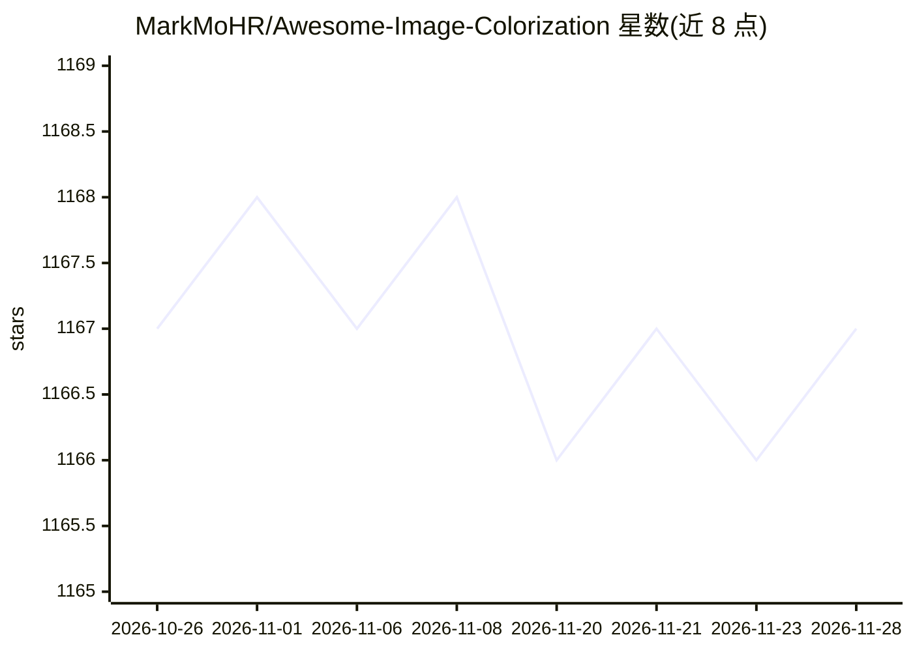

# MarkMoHR/Awesome-Image-Colorization

⭐ 1,167 · 推送 2026-11-27 · [GitHub](https://github.com/MarkMoHR/Awesome-Image-Colorization) · 个人维护

**深度学习图像/视频上色论文与代码集合清单**

以表格形式收录基于深度学习的图像与视频上色相关论文及对应代码/项目链接，按综述、自动上色、用户引导上色（涂鸦式、参考图式）分节组织，每节下区分软件/Demo 与论文条目，并标注论文出处会议期刊（SIGGRAPH、CVPR、ECCV 等）。面向查找上色研究资料与实现代码的用户，内容持续接受 PR 更新。仓库本身不含可安装运行的代码，仅提供外部链接。

## 筛选速览

| 维度 | 判定 | 备注 |
|---|---|---|
| AI 角色 | `ai-knowledge` | 知识聚合/清单类 |
| 许可风险 | `none` | — |
| 部署形态 | `None` |  |
| 模型依赖 | — | README 未给出锁定关系 |
| 硬件要求 | — | 无带数字的原话,不猜 |
| 安装摩擦 | `low` | 无编译、无系统依赖或容器化 |
| 成熟度 | — | 结构信号不足 |

## 能力要点

- 收录综述、自动上色、用户引导上色（涂鸦/参考图）三类论文条目
- 条目附带代码或项目页面链接（含 DeOldify、DDColor 等）
- 同时覆盖自然图像与线稿/漫画/草图上色方向

## 适用场景

- 查找图像上色方向的论文与开源实现
- 按会议/方法类别了解上色研究脉络
- 寻找老照片或线稿上色的现成工具

## 场景标签

`精选清单` · 领域:学习与行业

## 证据(README 行号)

> L5: A collection of **Deep Learning** based Image Colorization papers and corresponding source code/demo program, includ
> L15: ## 0. Survey

## 星数曲线

2026-10-26 1,167 → 2026-11-28 1,167（+0）

---
*卡片 v1 · prompt 1.4 · 生成 2026-11-28 · 置信度 high · 依据 README sha `c34b05a5e21d` · [字段定义](../../DATASET.md)*
