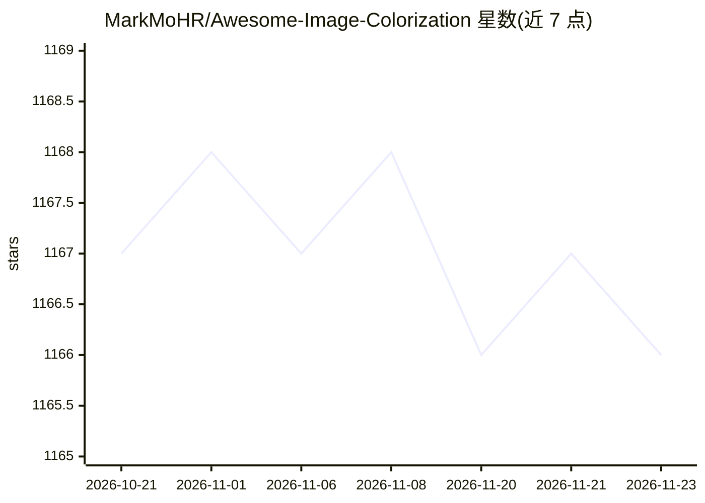

# MarkMoHR/Awesome-Image-Colorization

⭐ 1,166 · 推送 2026-11-16 · [GitHub](https://github.com/MarkMoHR/Awesome-Image-Colorization) · 个人维护

**基于深度学习的图像/视频上色论文合集清单**

以论文索引形式整理深度学习图像与视频上色研究，按综述、自动上色（含软件/Demo 与自然图像、线稿论文）、用户引导上色（涂鸦式、参考图式，分自然图像与素描/线稿）分类组织；每条条目附会议来源及可用的代码或项目页链接，欢迎通过 PR 或 issue 补充。本体是文献清单而非可运行软件，面向查找上色方法与代码实现的研究者与开发者。

## 筛选速览

| 维度 | 判定 | 备注 |
|---|---|---|
| AI 角色 | `ai-knowledge` | 知识聚合/清单类 |
| 许可风险 | `none` | — |
| 部署形态 | `None` |  |
| 模型依赖 | — | README 未给出锁定关系 |
| 硬件要求 | — | 无带数字的原话,不猜 |
| 安装摩擦 | `low` | 无编译、无系统依赖或容器化 |
| 成熟度 | — | 结构信号不足 |

## 能力要点

- 收录综述、自动上色、用户引导上色（scribble 与参考图）等分类的论文条目
- 多数条目附官方代码仓库或项目页链接
- 单列 Software/Demo 区块收录 DeOldify、Palette.fm 等可用工具
- 覆盖自然图像、线稿、漫画、图标等多种图像类型

## 适用场景

- 查找某个上色方向的代表论文及其开源实现
- 调研自动与交互式上色方法的发展脉络
- 为老照片或线稿上色挑选合适的开源工具

## 场景标签

`图像视频处理` `精选清单` · 领域:学习与行业

## 证据(README 行号)

> L5: A collection of **Deep Learning** based Image Colorization papers and corresponding source code/demo program, includ
> L11: **Outline**
> L15: ## 0. Survey

## 星数曲线

2026-10-21 1,167 → 2026-11-23 1,166（-1）

---
*卡片 v1 · prompt 1.4 · 生成 2026-11-23 · 置信度 high · 依据 README sha `292aa52f817c` · [字段定义](../../DATASET.md)*
