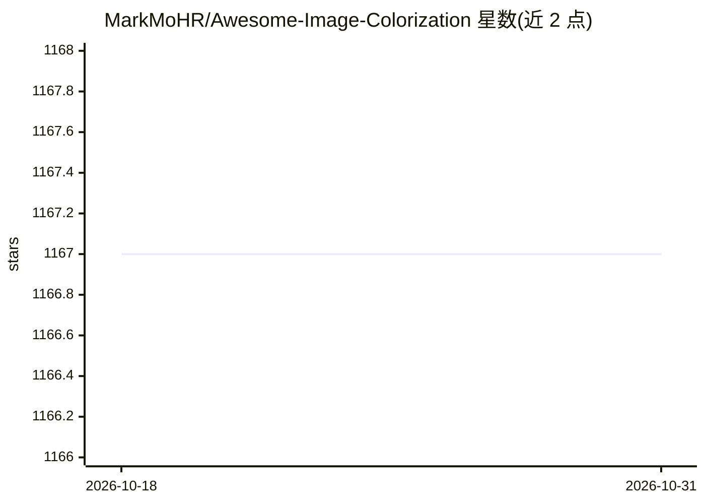

# MarkMoHR/Awesome-Image-Colorization

⭐ 1,167 · 推送 2026-10-28 · [GitHub](https://github.com/MarkMoHR/Awesome-Image-Colorization) · 个人维护

**深度学习图像/视频上色论文与代码的策展清单**

收集基于深度学习的图像与视频上色论文及对应源代码、项目主页和在线 Demo 的 Awesome 清单。内容按自动上色、用户引导上色（基于涂鸦/参考图）组织，覆盖自然图像、线稿、素描、漫画等图像类型，条目含发表来源（ICCV/SIGGRAPH/ACM MM 等）及第三方软件服务链接。README 未收录本仓库自身的代码，仅提供链接索引，接受 PR 补充。

## 筛选速览

| 维度 | 判定 | 备注 |
|---|---|---|
| AI 角色 | `ai-knowledge` | 知识聚合/清单类 |
| 许可风险 | `none` | — |
| 部署形态 | `None` |  |
| 模型依赖 | — | README 未给出锁定关系 |
| 硬件要求 | — | 无带数字的原话,不猜 |
| 安装摩擦 | `low` | 无编译、无系统依赖或容器化 |
| 成熟度 | — | 结构信号不足 |

## 能力要点

- 按自动/用户引导（涂鸦、参考图）两大类组织条目
- 覆盖自然图像、线稿、素描、漫画等多图像类型
- 条目附论文出处与代码/项目页/Demo 链接

## 适用场景

- 查找上色方向的论文及开源实现
- 对比不同交互方式（自动/涂鸦/参考图）的上色方法
- 寻找可用的在线上色服务或 Demo

## 场景标签

`精选清单` · 领域:学习与行业

## 证据(README 行号)

> L5: A collection of **Deep Learning** based Image Colorization papers and corresponding source code/demo program, includ

## 星数曲线

2026-10-18 1,167 → 2026-10-31 1,167（+0）

---
*卡片 v1 · prompt 1.4 · 生成 2026-10-21 · 置信度 high · 依据 README sha `98aa03ee121c` · [字段定义](../../DATASET.md)*
