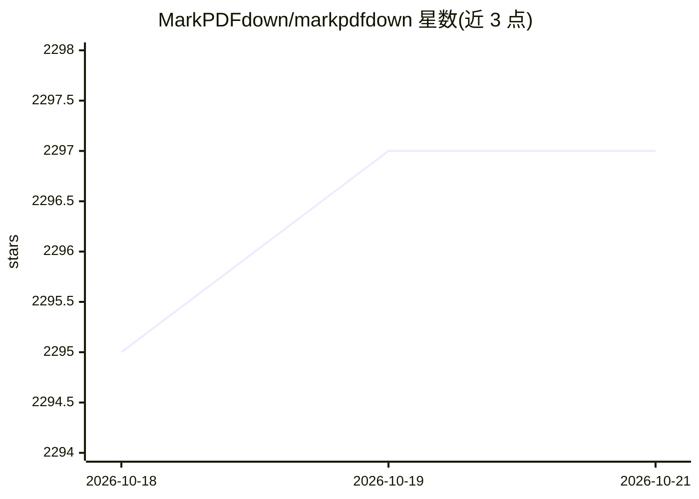

# MarkPDFdown/markpdfdown

⭐ 2,303 · Python · Apache-2.0 · 推送 2026-09-23 · [GitHub](https://github.com/MarkPDFdown/markpdfdown) · 组织维护 · 中文 README

**基于多模态大模型的 PDF/图片转 Markdown 转录工具**

通过 LiteLLM 调用多模态大模型，将 PDF 与图片转录为 Markdown 文本，保留标题、列表、表格等格式结构，支持 OpenAI、OpenRouter、Requesty 等提供商。以 CLI 形式提供文件模式与管道模式，支持页码范围选择，另有 npx 启动的桌面应用（独立仓库）。需配置 API key，要求 Python 3.9+，提供 Docker 构建方式。

## 筛选速览

| 维度 | 判定 | 备注 |
|---|---|---|
| AI 角色 | `ai-native` | 本体是模型或模型工具 |
| 许可风险 | `permissive` | Apache-2.0 |
| 部署形态 | `self-host` | docker 或自建部署 |
| 模型依赖 | — | README 未给出锁定关系 |
| 硬件要求 | — | 无带数字的原话,不猜 |
| 安装摩擦 | `low` | 无编译、无系统依赖或容器化 |
| 成熟度 | — | 结构信号不足 |

## 能力要点

- 多模态大模型转录 PDF/图片为 Markdown，保留表格与格式结构
- 经 LiteLLM 支持 OpenAI、OpenRouter、Requesty 提供商
- CLI 支持文件模式、管道模式与页码范围选择
- 提供 Docker 构建与独立桌面应用

## 适用场景

- 把论文或报告 PDF 转成可编辑的 Markdown 文档
- 批量转换含表格公式的复杂文档
- 在管道中通过 stdin/stdout 集成 PDF 转换

## 场景标签

`文档解析` · 领域:知识与检索

## 证据(README 行号)

> L8:  A powerful tool that leverages multimodal large language models to transcribe PDF files into Markdown format.
> L24: MarkPDFDown is designed to simplify the process of converting PDF documents into clean, editable Markdown text. By 
> L30: - **Multi-Provider Support**: Supports OpenAI, OpenRouter, and Requesty through LiteLLM

## 星数曲线

2026-10-18 2,295 → 2026-10-21 2,297（+2）

---
*卡片 v1 · prompt 1.4 · 生成 2026-10-21 · 置信度 mid · 依据 README sha `f12e88a9db7f` · [字段定义](../../DATASET.md)*
