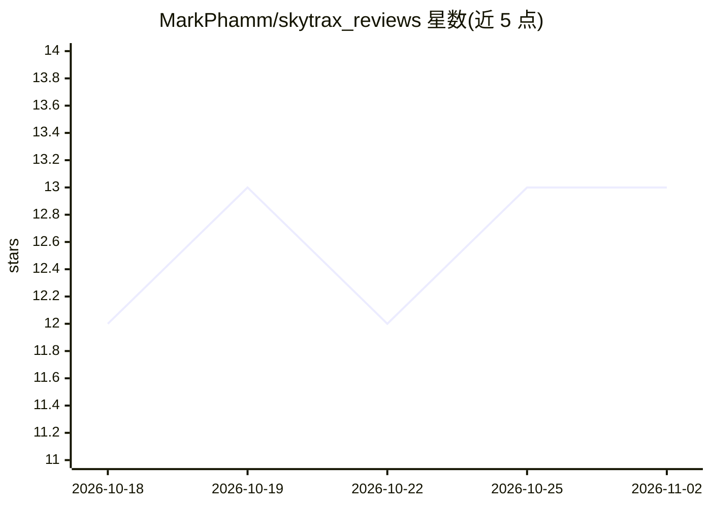

# MarkPhamm/skytrax_reviews

⭐ 13 · HTML · MIT · 推送 2026-09-20 · [GitHub](https://github.com/MarkPhamm/skytrax_reviews) · [官网](https://markphamm.github.io/skytrax_reviews/#1) · 组织维护

**Skytrax 航空评论的端到端 ELT 数据平台总览仓库**

作为伞形仓库提供项目叙事、架构说明与各子仓库链接，本身不含实现代码。数据链路为：Python/BeautifulSoup 抓取 AirlineQuality.com 四类评论（站点已永久关闭，数据为历史抓取存档）→ S3 暂存 → Snowflake COPY INTO → dbt Kimball 星型模型 → Mode 仪表盘，覆盖约 160K+ 行评论。用 Airflow (Astronomer) 编排、Terraform 管理 AWS/Snowflake 资源、GitHub Actions CI/CD 与 OIDC 认证。限制：数据源已关闭，EL 路径是可重放的归档而非持续数据流；README 自述评论存在自选择偏差。

## 筛选速览

| 维度 | 判定 | 备注 |
|---|---|---|
| AI 角色 | `ai-enhanced` | 去掉 AI 部分产品仍成立 |
| 许可风险 | `permissive` | MIT |
| 部署形态 | `None` |  |
| 模型依赖 | — | README 未给出锁定关系 |
| 硬件要求 | — | 无带数字的原话,不猜 |
| 安装摩擦 | `low` | 无编译、无系统依赖或容器化 |
| 成熟度 | — | 结构信号不足 |

## 能力要点

- 三段式 Airflow DAG 通过 Datasets 事件驱动串联抓取/处理/加载
- dbt 星型模型（fct_review 增量合并 + 5 个维度表）与 Bronze/Silver/Gold 分层
- Terraform 管理 S3、Snowflake RBAC、PII 标签脱敏、CloudFront、OIDC
- 治理项：质量门禁、LOAD_AUDIT 对账、dbt 测试、来源新鲜度告警

## 适用场景

- 分析航空公司评论满意度（Delta/Spirit/Frontier 等仪表盘）
- 参考端到端 ELT 数据栈的架构与 DataOps 实践
- 复用历史 Skytrax 存档数据做航司评论分析

## 场景标签

`网页抓取` · 领域:效率与自动化

## 证据(README 行号)

> L3: End-to-end airline review analytics: scrape AirlineQuality.com → stage on S3 → load Snowflake → dbt star schema (med
> L70: |Extract|Python 3.12, BeautifulSoup, pandas|No public API — custom scrape of AirlineQuality.com (site now permanent

## 星数曲线

2026-10-18 12 → 2026-11-02 13（+1）

---
*卡片 v1 · prompt 1.4 · 生成 2026-10-31 · 置信度 low · 依据 README sha `e8f03f3fbab3` · [字段定义](../../DATASET.md)*
